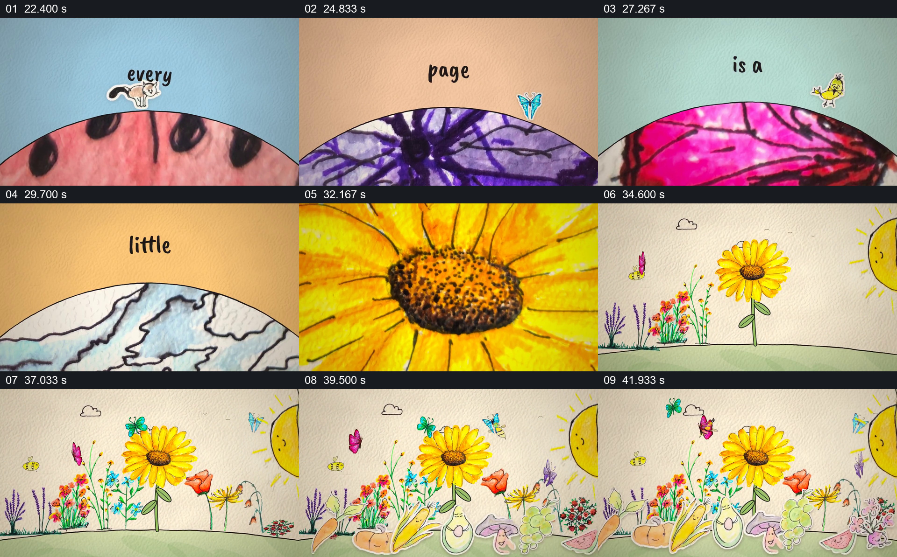

# 让局部图案穿过弧窗，最后长成完整花园

- 作品：案例 017《手绘剪纸角色与纸面世界》（索引名称）。
- 原片范围：00:22.000–00:44.000，含起点、不含终点；[完整原片](../video.mp4)｜[本卡片段](c02.mp4)。
- 观察方式：依据整片 64 宫格和约每秒一次的真实源帧观察，未连续原速观看或听审；声音、语气与完整播放节奏未确认。

## 原画面具体怎样设计

画面下半部像翻开的弧形纸页，内部连续出现瓢虫、风景、花纹和植物细节；上方逐词组成“every page is a little world”。向日葵花心占据画面后，视野拉远到完整花朵和绿色地面；周围陆续加入其他花、蝴蝶及前景手绘角色，形成拥挤的花园。

## 为什么这样设计，好在哪里

先让观众从局部纹理辨认不同页面，再把其中一朵花放回全景，体现局部与完整世界的关系。后续植物和角色不是另一个无关拼贴，而是围绕已建立的花补充尺度与生活感。

以上为依据画面的分析，非作者自述；预期观看效果未经观众测试。

## 可直接使用的创意指令

当要让观众从细节进入插画世界时，选择几幅有辨识度的局部，在同一开口或纸页结构中依次展示，并让简短文字说明它们的共同关系；选定其中一处作承接，把它从近景扩大或拉远到完整对象，再逐步加入能形成场景的植物、人物或其他配角。保证源图分辨率足以支撑局部观察，画面内部没有真实动作时不要冒称实拍运动。
