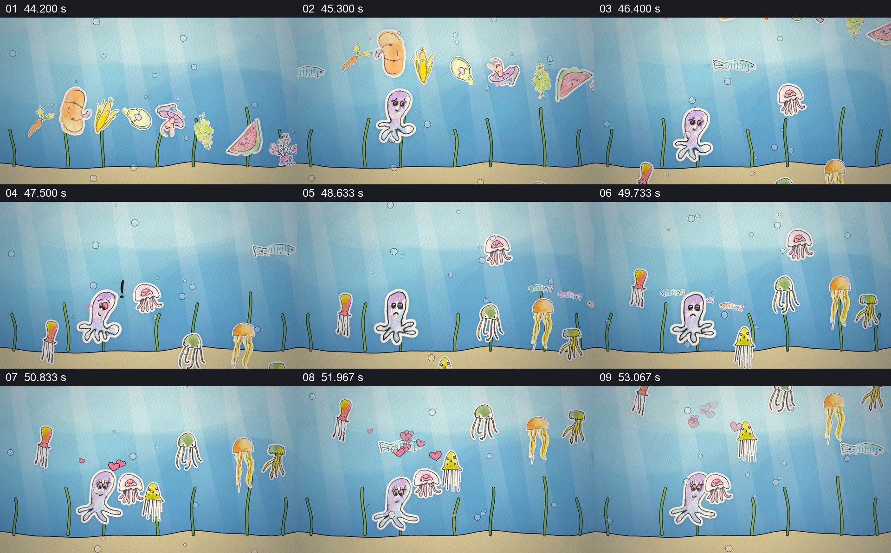

# 把地面花园换成海底群像

- 作品：案例 017《手绘剪纸角色与纸面世界》（索引名称）。
- 原片范围：00:44.000–00:54.000，含起点、不含终点；[完整原片](../video.mp4)｜[本卡片段](c03.mp4)。
- 观察方式：依据整片 64 宫格和约每秒一次的真实源帧观察，未连续原速观看或听审；声音、语气与完整播放节奏未确认。

## 原画面具体怎样设计

蓝色水下场景中有简化海床与竖直水草；花园里的彩色剪纸角色经过画面上方，章鱼、水母等不同轮廓出现在中下部和较高位置，后续抽帧中生物及小心形的相对位置发生变化，海床保持。

## 为什么这样设计，好在哪里

固定海床和水草给漂浮角色提供空间参照，不同高度和大小让群像容易区分。沿用剪纸边缘与手绘轮廓，把环境变化接回同一作品的视觉语言。

以上为依据画面的分析，非作者自述；预期观看效果未经观众测试。

## 可直接使用的创意指令

当已建立的一组角色要进入新环境时，先设置一两个可辨识的环境参照，再将主要角色和新配角安排在不同高度或前后位置，让观众同时看清谁在场、环境如何改变。保留原有画风或其他身份线索以维持连续；运动形式依据实际可用素材和目标表现决定。
