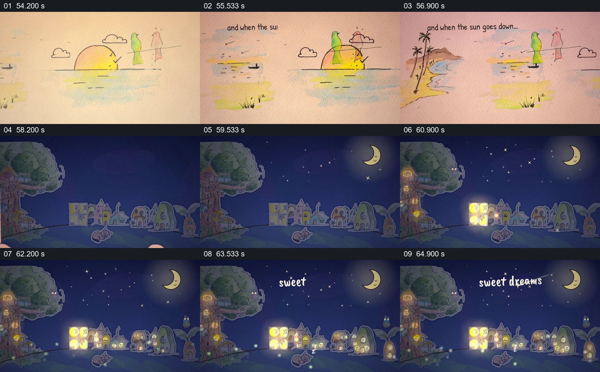

# 从日落纸页翻到点灯的夜间村庄

- 作品：案例 017《手绘剪纸角色与纸面世界》（索引名称）。
- 原片范围：00:54.000–01:06.000，含起点、不含终点；[完整原片](../video.mp4)｜[本卡片段](c04.mp4)。
- 观察方式：依据整片 64 宫格和约每秒一次的真实源帧观察，未连续原速观看或听审；声音、语气与完整播放节奏未确认。

## 原画面具体怎样设计

浅色纸面上出现半落的太阳、水面与岸边小景，并写“and when the sun goes down...”。画面换成深蓝夜景，树屋、小房子和弯月出现，窗户逐渐亮起，星点和“sweet dreams”文字留在夜空。

## 为什么这样设计，好在哪里

太阳下落的纸面图像先为时间变化提供线索，夜景的月亮、点亮的窗户与晚安文字共同完成状态转换。视觉元素很少，却分别负责时段、居住环境和情绪收束。

以上为依据画面的分析，非作者自述；预期观看效果未经观众测试。

## 可直接使用的创意指令

当需要表达从活动进入休息时，先以可辨的日落或其他时间线索建立变化，再转到同一世界的夜间环境；用窗灯、月亮等少量状态变化说明新的时间，并留出一句简短收尾。环境与角色的对应关系应在前后建立，不把示意日夜变化当作真实时间记录。
