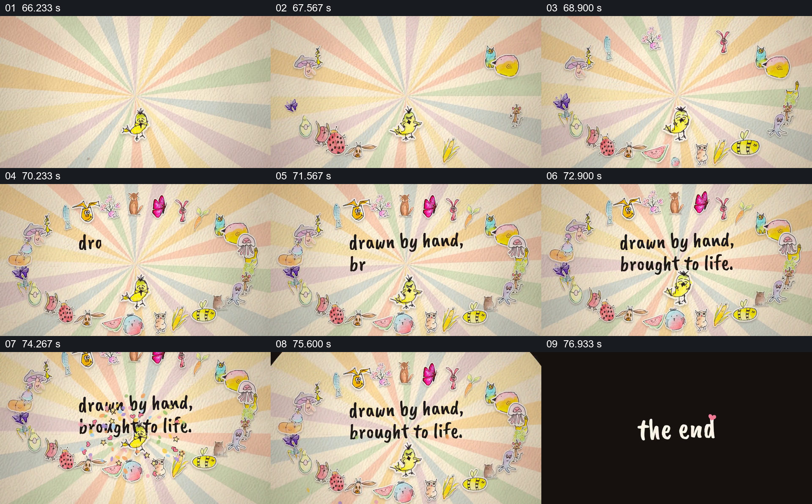

# 把不同场景的角色围成一圈作谢幕

- 作品：案例 017《手绘剪纸角色与纸面世界》（索引名称）。
- 原片范围：01:06.000–01:18.058，含起点、不含终点；[完整原片](../video.mp4)｜[本卡片段](c05.mp4)。
- 观察方式：依据整片 64 宫格和约每秒一次的真实源帧观察，未连续原速观看或听审；声音、语气与完整播放节奏未确认。

## 原画面具体怎样设计

浅色放射纸纹上，先有少量角色分散在边缘，随后动物、植物与海底角色围成一圈，中央保留空白并出现“drawn by hand, brought to life.”。最后画面收成黑底小圆，出现“the end”。

## 为什么这样设计，好在哪里

角色环把前面分散在不同环境中的形象重新放在一起，中央留白使收尾说明可读；环形结构让谢幕同时有群体感和明确的视觉中心。

以上为依据画面的分析，非作者自述；预期观看效果未经观众测试。

## 可直接使用的创意指令

当作品需要在结尾召回不同场景的角色时，选择观众已经见过的主要角色，让它们从画面边缘逐步围成稳定的环或其他有中心留白的队形；把一句反映作品特征的短句放在中心，停留后再收至结束画面。角色大小、队形和背景按作品适配，避免数量过多而无法辨认。
