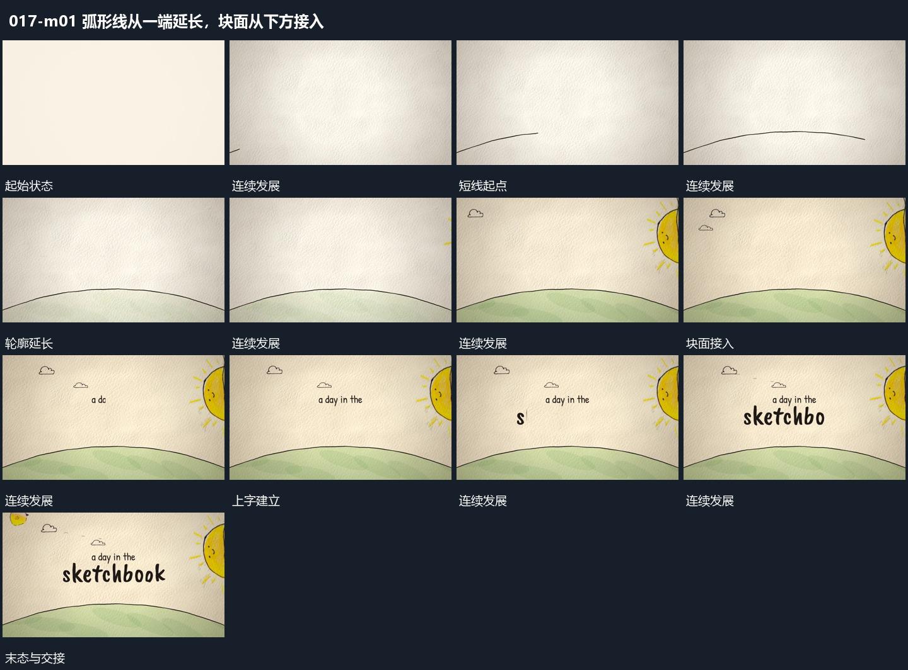

# 弧形线从一端延长，块面从下方接入

## 运动指令

从一端延长弧形线，使它逐渐跨过画面。下方块面随后接入填到边界，外围短形建立，上方字组逐词补齐，已画出的线不退去。

## 视频切片

[播放本机制的原片切片](m01.mp4)

保留起始准备、连续发展和完成或明确交接；首尾按本段运动范围裁切，不拼接、不变速。尾部只保留理解结果所需的展示。

## 分镜过程

## 组合与调整

可改曲率，保留边界先于填充的关系。
