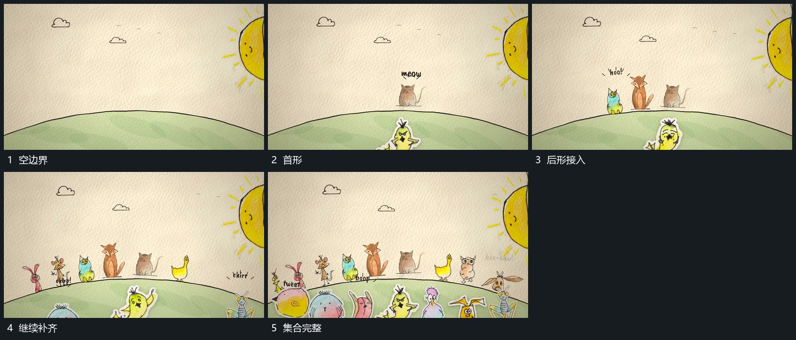

# 小形沿共同弧线逐项建立，已有项保持

## 运动指令

在弧形边界上逐项接入小形，各自停在不同落点，已出现的保持并小幅活动。下方另有小形接入，形成两层累积，上方文字最后建立。

## 视频切片

[播放本机制的原片切片](m02.mp4)

覆盖分镜中“空边界”至“集合完整”的连续过程，并保留邻近的前后衔接画面；原片中交叠发生的动作一并保留。

## 分镜过程

## 组合与调整

数量可减，保留沿共同边界的空间参照，避免每个都漂到独立无关位置。
