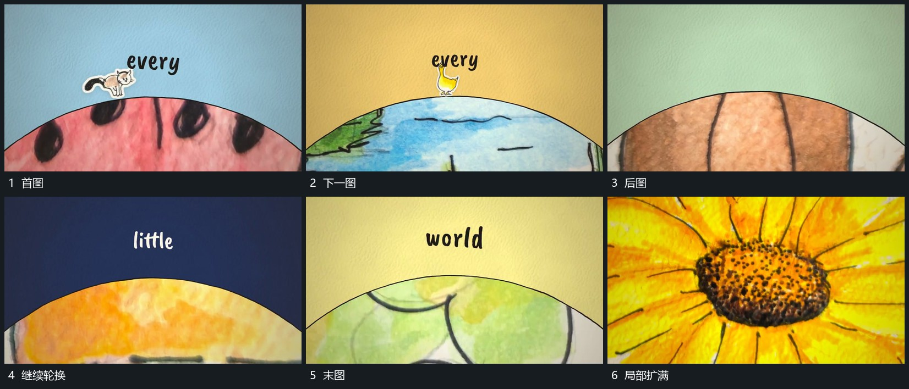

# 弧线下内容连续更换，末项放大接管

## 运动指令

保持上部空区与弧形边界，连续替换边界下的图像；每次更换时前景小形在边缘附近短暂接力。末项推近，内部图像扩大接管全幅，再换入下一完整场面。

## 视频切片

[播放本机制的原片切片](m03.mp4)

覆盖分镜中“首图”至“局部扩满”的连续过程，并保留邻近的前后衔接画面；原片中交叠发生的动作一并保留。

## 分镜过程

## 组合与调整

可改轮换数量，身份不明的图像明确为替换，不说成同一形真实变形。
