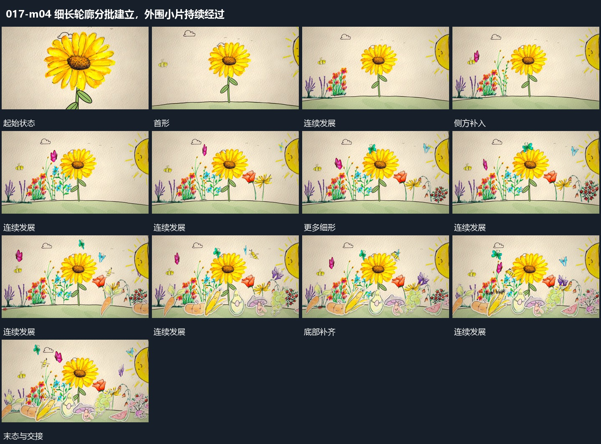

# 细长轮廓分批建立，外围小片持续经过

## 运动指令

沿稳定底边分批建立细长轮廓，先中心后周边，已出现的保持。外围小片从不同方向持续经过，后段再在底部补入短形，形成逐渐填满的空间。

## 视频切片

[播放本机制的原片切片](m04.mp4)

覆盖分镜中“首形”至“外围继续”的连续过程，并保留邻近的前后衔接画面；原片中交叠发生的动作一并保留。

## 分镜过程

## 组合与调整

新片保留层间独立运动，不能把所有小片一起横移。
