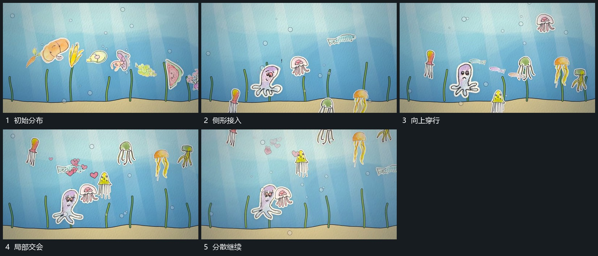

# 活动体沿不同曲线向上穿行，底边保持

## 运动指令

保持底部边界，让活动体沿不同曲线缓慢向上穿行，外围圆点也上移但速度不同。较近的形经过前层，其他形仍在后方，短小附属形随后散出。

## 视频切片

[播放本机制的原片切片](m05.mp4)

覆盖分镜中“初始分布”至“分散继续”的连续过程，并保留邻近的前后衔接画面；原片中交叠发生的动作一并保留。

## 分镜过程

## 组合与调整

可减数量，保留不同路径与速度，不推断真实流体或物理运动。
