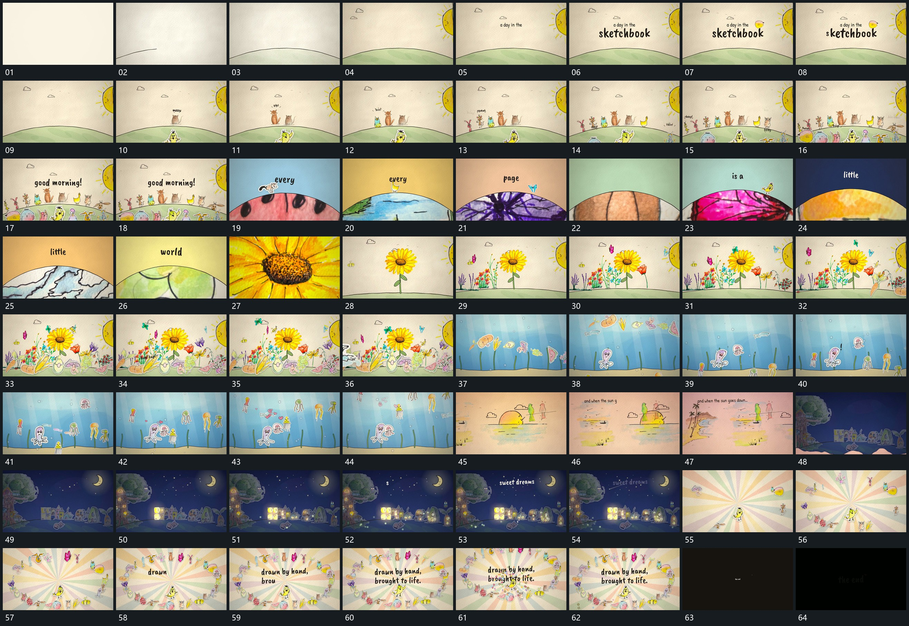

# 017｜原片运动总览

[观看完整原片](video.mp4)

## 运动总览

开头 弧形线从一端延长，块面从下方接入 延长弧形线并补入其下方块面，字组在上方建立。小形沿共同弧线逐项建立，已有项保持 沿弧线逐项补入小形，前面的留住，数量逐渐增多。随后 弧线下内容连续更换，末项放大接管 把弧线下的内容连续替换，前景小形在边界附近短暂接力，最后局部放大接管。

中段 细长轮廓分批建立，外围小片持续经过 在稳定底边上从少到多建立细长轮廓，周边小片持续沿不同方向经过。换入新的分层后 活动体沿不同曲线向上穿行，底边保持 让活动体从下往上穿行，圆点与外围形跟着不同路径移动，底部边界保持。

后段底层更换，上方短句建立，前景局部下移并退出。新的场面逐项点亮内部小格，再转入 外围散形围绕中央，字组建立后局部集中增多 的外围散形与中央字组；散形先围绕，再集中增加，末尾退为短句收尾。

## 完整运动段落

以下按原片中的出现顺序引用。建立、内部发展及完成反馈放在同一段中；同时发生的局部动作与运镜写在同一份指令里。不同段之间可以是连续接管，也可以是直接切换，不能仅凭条目相邻认定可直接拼接。重复出现的同类运动采用一次连续代表范围，切片不以逐段无缝覆盖整片为目标。

1. [弧形线从一端延长，块面从下方接入](mechanisms/m01.md)：轮廓先定义范围，填充随后承接

2. [小形沿共同弧线逐项建立，已有项保持](mechanisms/m02.md)：按不同落点接入，前项不随后项出现退出

3. [弧线下内容连续更换，末项放大接管](mechanisms/m03.md)：边界保持，内部替换，前景小形短暂接力

4. [细长轮廓分批建立，外围小片持续经过](mechanisms/m04.md)：已有细形保持，后项补空位，外围独立移动

5. [活动体沿不同曲线向上穿行，底边保持](mechanisms/m05.md)：个体路径不同，边界不跟随

6. [外围散形围绕中央，字组建立后局部集中增多](mechanisms/m06.md)：中央稳定，外围绕行与新增错开

切片保留起始准备、必要内部停顿和完成或明确交接；首尾省略无新发展的等待，持续运动不要求人为停住。以上基于真实源帧序列和重点边界核对，不等同于全片连续声画审片。

## 完整64宫格

