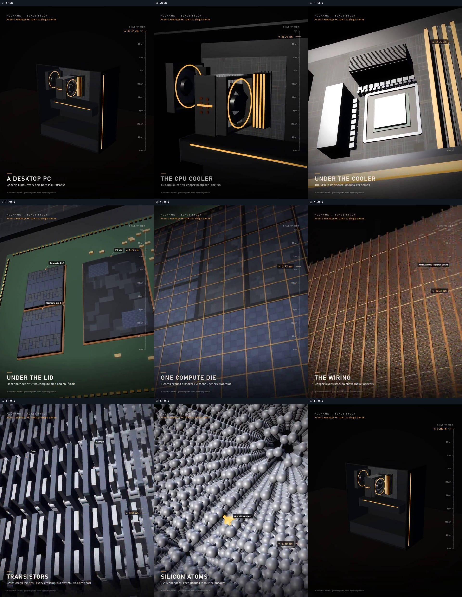

# 从电脑一层层进入芯片，再沿尺度退回整机

- 作品：案例 098。
- 原片范围：00:00.000–00:44.000（源时间，含起点、不含终点）；[完整原片](../video.mp4)｜[本卡片段](../video.mp4)。范围与既有片段一致，复用原片，另从原片补制覆盖尾段结果的分镜。
- 观察方式与未确认范围：核看全片 64 帧总览和本卡九宫格；未独立连续原速观看或听审，抽帧间运动、精确节奏、声音和同步未确认。价值判断为作品分析，跨项目迁移尚未实测。

## 原画面具体怎样设计

黑色空间中央先是一台带透明侧面的电脑主机，旁边有小型刻度和界面标记，左下标题“A DESKTOP PC”标识当前观察层级。观察位置逐渐靠近机箱内的散热风扇，原本能看见的整机边框退到画面外；同一方向上散热组件被移开，处理器盖板在主板上显露，左下标题随之更新。

盖板区域扩大后，画面进入绿色底板上的多个芯片区域，再聚焦其中一块芯片、一个核心与密集布线。蓝色网格、橙色连线和小标签保留当前层级之间的方向关系；镜头所见再变成规律排列的逻辑单元与晶体管。每次局部占满画面前，前一层仍短暂可辨，接着它成为新的观察环境。

接近末尾，一个晶体管局部的不同色块放大为充满画面的材料层，随后出现大量球体组成的硅原子示意；一处黄色标记在灰白球阵中突出。最后一组源帧依次回到材料、晶体管、布线、散热器和电脑整机，左下层级名称随之回收。源帧能确认层级的先后状态，不能确认完整退回速度或每个转接是否无切点。

## 为什么这样设计，好在哪里

先给熟悉的电脑和方向，再把目标放在已认识的外壳内部，让新尺度从一个可指认的局部生长出来。固定的黑底、小标签和底部层级名为不断变化的形态提供坐标；橙色线条从大构件延续到芯片区域，帮助注意力追随局部。

末尾回看不是另一个新物件，而是让已经看过的层级重新连回最初电脑，形成“它原来在这里”的结果。此处是对视觉组织的分析；画面中的大小、芯片结构和球体是示意，准确性仍需以来源核对。

## 可直接使用的创意指令

适用于从可见整体解释不可直接看到的内部层级。先选择一个熟悉的整体对象，标出下一层的位置；把该局部扩大成新环境前，保留足够的外层结构让观众知道自己进入哪里。每进入一层都用简短名称、方向或尺度标记确认当前对象，直至出现目标细节；最后按可理解的顺序回到一个更大的已知参照。

可用真实显微图、剖面图、三维模型或实拍组合，颜色和视觉速度可变；关键是每级之间有可核查的包含关系，层级变化时名称清楚。缺少真实比例或内部图像时应标为示意，不能将艺术化连续放大当作真实成像。
