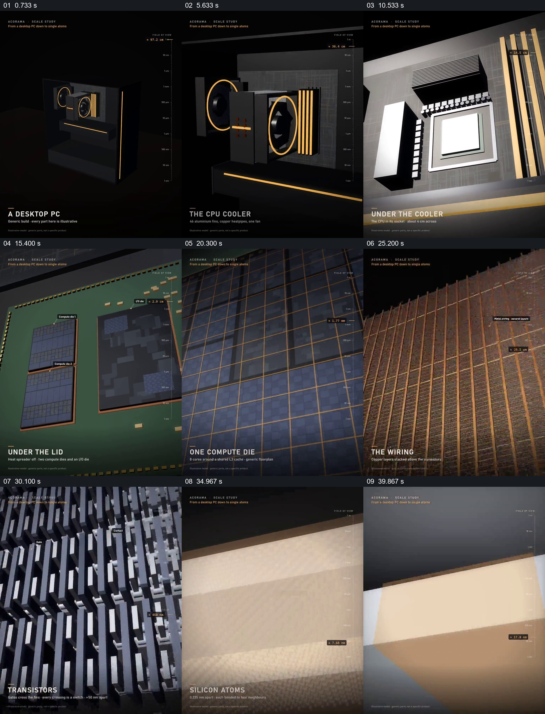

# 让观察尺度逐层深入，再回到最初的电脑

- 作品：案例 098《从电脑进入芯片与原子》（本次概括）。
- 原片范围：00:00.000–00:44.000，含起点、不含终点；[完整原片](../video.mp4)｜[本卡片段](../video.mp4)。
- 观察方式：依据约每秒一次的真实源帧观察，未连续原速观看或听审；声音、语气与完整播放节奏未确认。

## 原画面具体怎样设计

黑底上先建立台式电脑及标尺，画面靠近并移开处理器散热器，显出芯片盖；进一步进入芯片区域、计算核心、布线和逻辑单元，逐层靠近晶体管及硅原子的排列。最后快速返回较大层级和整机，底部标题随观察对象改变。

## 为什么这样设计，好在哪里

从可识别的电脑出发，每一步将前一个区域放大为新的环境，使极小结构有来源位置；回到整机则将尺度变化收束。模型和尺度数值为作品示意，实际芯片结构需核验。

以上为依据画面的分析，非作者自述；预期观看效果未经观众测试。

## 可直接使用的创意指令

解释多尺度结构时，选有依据的整体和逐级包含关系，每次在上一层定位将要放大的区域，再展示下一层及相应尺度；必要时返回整体确认位置。模型、单位及视觉简化需标明依据，不能把示意当显微实拍。
