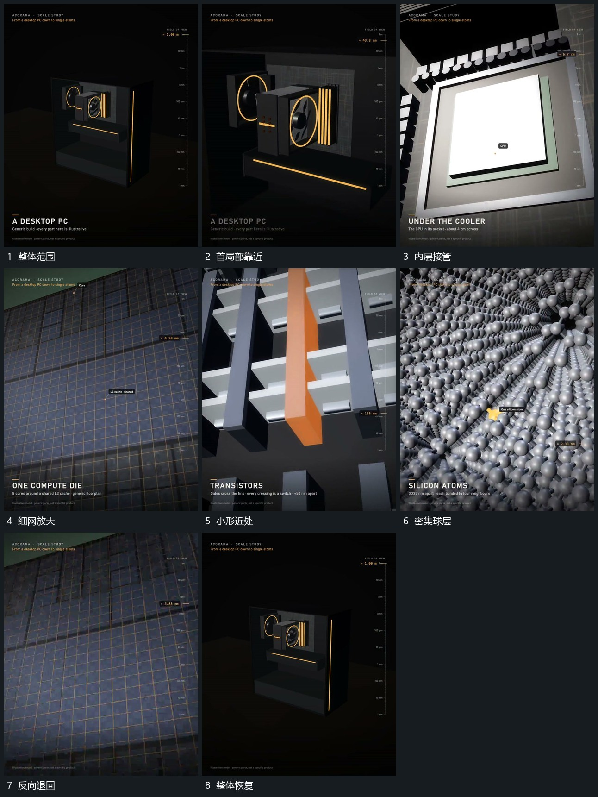

# 锁定局部逐级推近下一层承接再沿原路退回

## 运动指令

从完整结构中选定局部持续推近，旧边界逐步越界，内部下一层范围承接到相近中心。每一级保留少量旧层作为来源参照，再继续进入更细局部。末端稳定后沿相同层级反向后退，直到原整体恢复。

## 视频切片

[播放本机制的原片切片](m01.mp4)

覆盖分镜中“整体范围”至“整体恢复”的连续过程，并保留邻近的前后衔接画面；原片中交叠发生的动作一并保留。

## 分镜过程

## 组合与调整

不需要继承原片精确尺度；层级之间先有对应入口，再安排下一层揭示。
