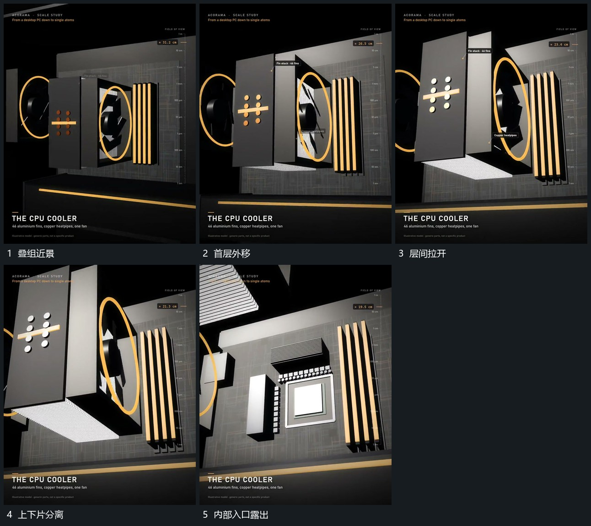

# 近层叠组向不同方向拉开露出内部入口

## 运动指令

保留内部平面，前方叠组先沿局部法向外移，随后上片向上、下片向下拉开，各层倾角随外移少量变化。圆组仍围原轴，内部入口随遮挡释放露出。下一取景在入口清楚后继续推进。

## 视频切片

[播放本机制的原片切片](m02.mp4)

覆盖分镜中“叠组近景”至“内部入口露出”的连续过程，并保留邻近的前后衔接画面；原片中交叠发生的动作一并保留。

## 分镜过程

## 组合与调整

各层可只选择一种外移方向；分离有先后，避免所有遮挡同时瞬间消失。
