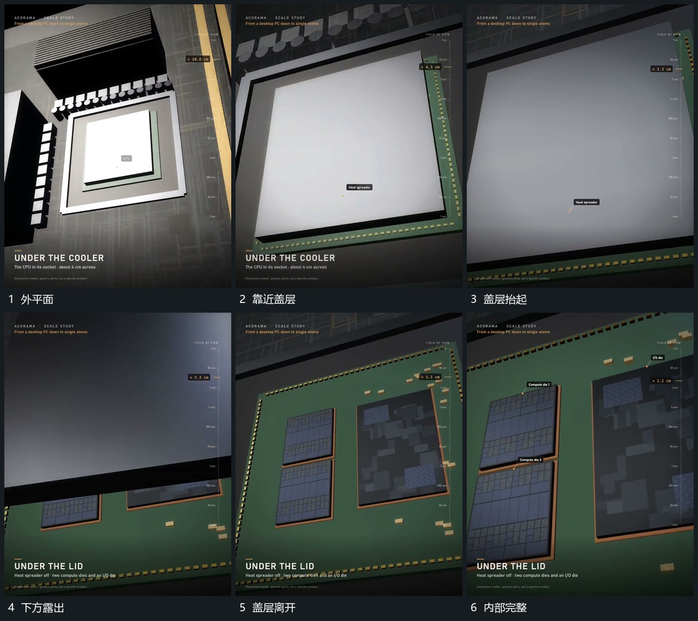

# 平面盖层抬离底面下方组逐步露出

## 运动指令

先靠近盖层局部，再让盖层保持平面方向向上抬离，底部位置不变。随着间隙增加下方小组逐步露出，盖层越界后取景继续推向其中一个区块，其他小组暂时保留作边缘参照。

## 视频切片

[播放本机制的原片切片](m03.mp4)

覆盖分镜中“外平面”至“内部完整”的连续过程，并保留邻近的前后衔接画面；原片中交叠发生的动作一并保留。

## 分镜过程

## 组合与调整

盖层可以沿侧方离开；保持打开前后的局部位置一致，不换成另一套无来源内部。
