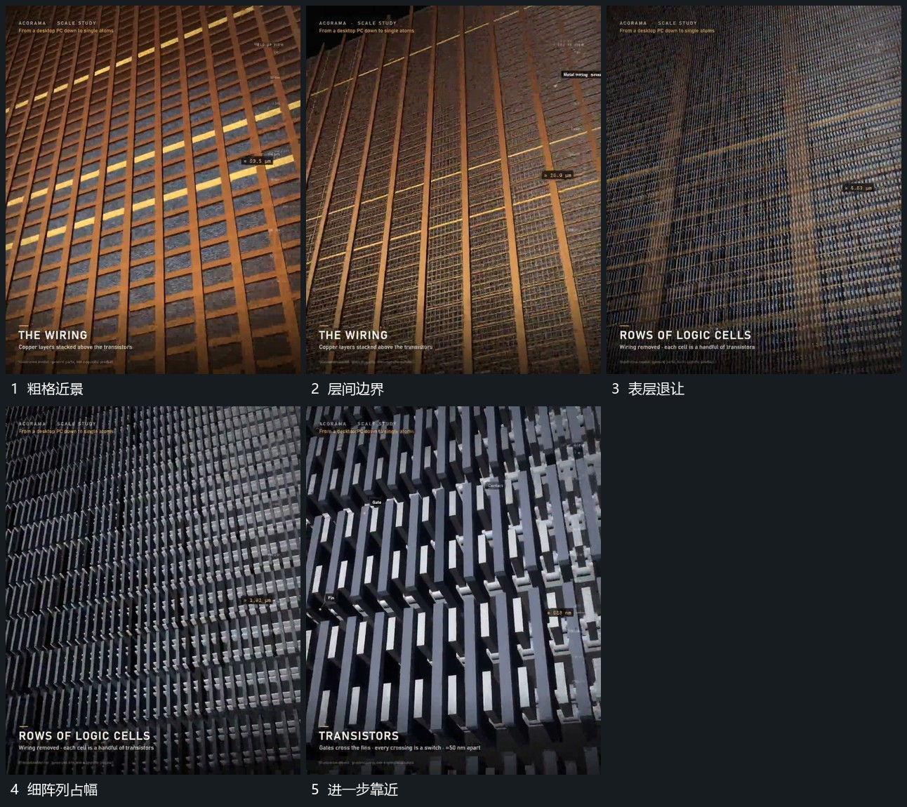

# 上方格层退让后下层细阵列接管近景

## 运动指令

靠近粗格状表层后逐步退让该层，使下方细阵列从相同区域露出。上层少量边界先保留，细阵列占主要范围后上层再退出；取景沿细阵列继续前进，局部小形由远到近可辨。

## 视频切片

[播放本机制的原片切片](m04.mp4)

覆盖分镜中“粗格近景”至“进一步靠近”的连续过程，并保留邻近的前后衔接画面；原片中交叠发生的动作一并保留。

## 分镜过程

## 组合与调整

只描述可见层级交接，不推定真实材料结构；可用任意粗细层组迁移。
