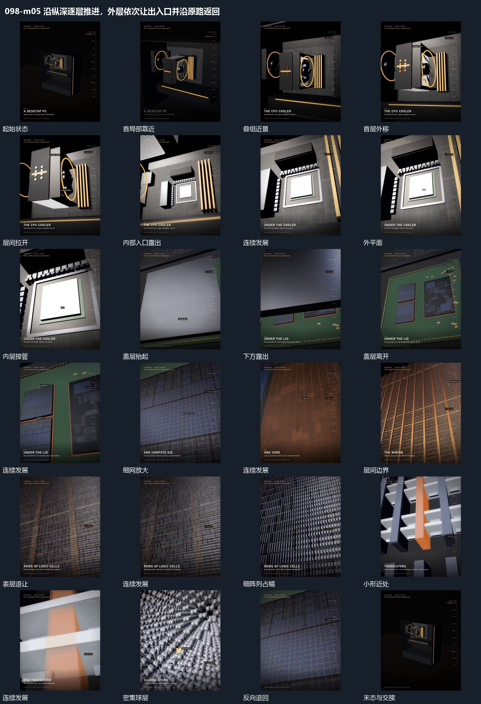

# 沿纵深逐层推进，外层依次让出入口并沿原路返回

## 运动指令

起始：完整结构在远处。

1. 锁定局部沿纵深推进，近层组件向不同方向拉开露出入口。

2. 盖层抬起，格层退让，下方细阵列接管近景。

3. 深入后沿原路径退回整体。

上述镜头变化与局部动作按同一条连续过程推进；写明同时发生的步骤在原场面中交叠，不先完成整段运镜再重演局部。

## 视频切片

[播放本机制的原片切片](m05.mp4)

保留起始准备、连续发展和完成或明确交接；首尾按本段运动范围裁切，不拼接、不变速。相连的小动作合为同一完整段落。

## 分镜过程

## 组合与调整

保留以下动作关系：锁定局部沿纵深推进，近层组件向不同方向拉开露出入口；盖层抬起，格层退让，下方细阵列接管近景；深入后沿原路径退回整体。

可调整位移距离、层级间距、重复数量与相对快慢；已有锚点和未退出的层继续承接。连接下一段时以切片末态为起点，另行设计不连续的状态转换。
