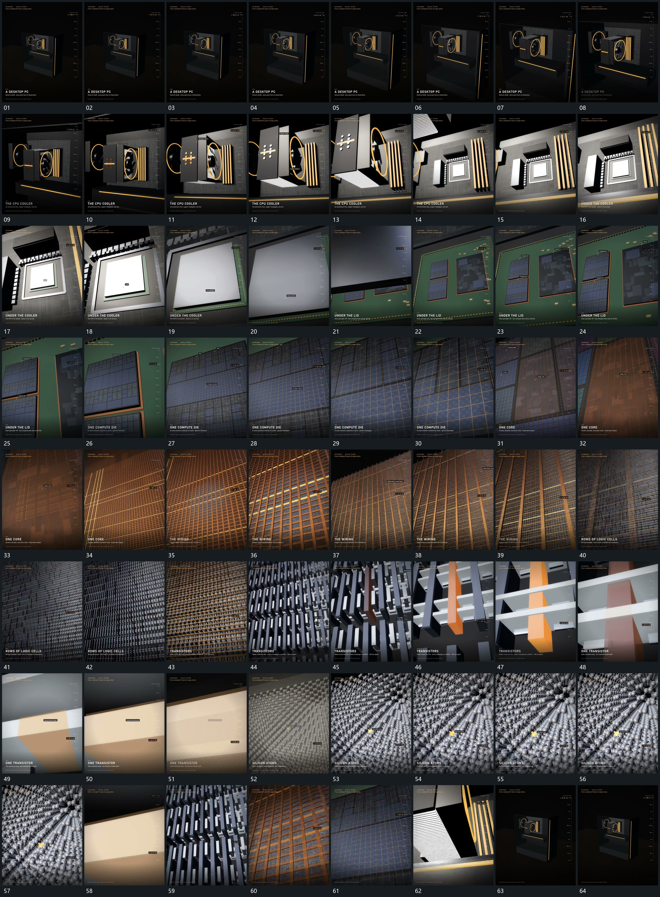

# 098｜原片运动总览

[观看完整原片](video.mp4)

## 运动总览

全片以锁定局部逐级推近下一层承接再沿原路退回锁定一个局部逐层推近，从整体范围进入越来越细的网格与小形。靠近外部叠层时近层叠组向不同方向拉开露出内部入口先沿不同方向拉开近层，给下一局部留下可见入口；平面盖层抬离底面下方组逐步露出把平面盖层抬离，露出下方并继续推入。

进一步靠近后，上方格层退让后下层细阵列接管近景退让上方格状层，露出更细的下层阵列。末段到达密集小球范围，取景保持局部后反向复用锁定局部逐级推近下一层承接再沿原路退回，沿各级参照快速退回最初全貌。

## 完整运动段落

以下按原片中的出现顺序引用。建立、内部发展及完成反馈放在同一段中；同时发生的局部动作与运镜写在同一份指令里。不同段之间可以是连续接管，也可以是直接切换，不能仅凭条目相邻认定可直接拼接。重复出现的同类运动采用一次连续代表范围，切片不以逐段无缝覆盖整片为目标。

1. [沿纵深逐层推进，外层依次让出入口并沿原路返回](mechanisms/m05.md)：锁定局部沿纵深推进，近层组件向不同方向拉开露出入口；盖层抬起，格层退让，下方细阵列接管近景；深入后沿原路径退回整体。

切片保留起始准备、必要内部停顿和完成或明确交接；首尾省略无新发展的等待，持续运动不要求人为停住。以上基于真实源帧序列和重点边界核对，不等同于全片连续声画审片。

## 完整64宫格

