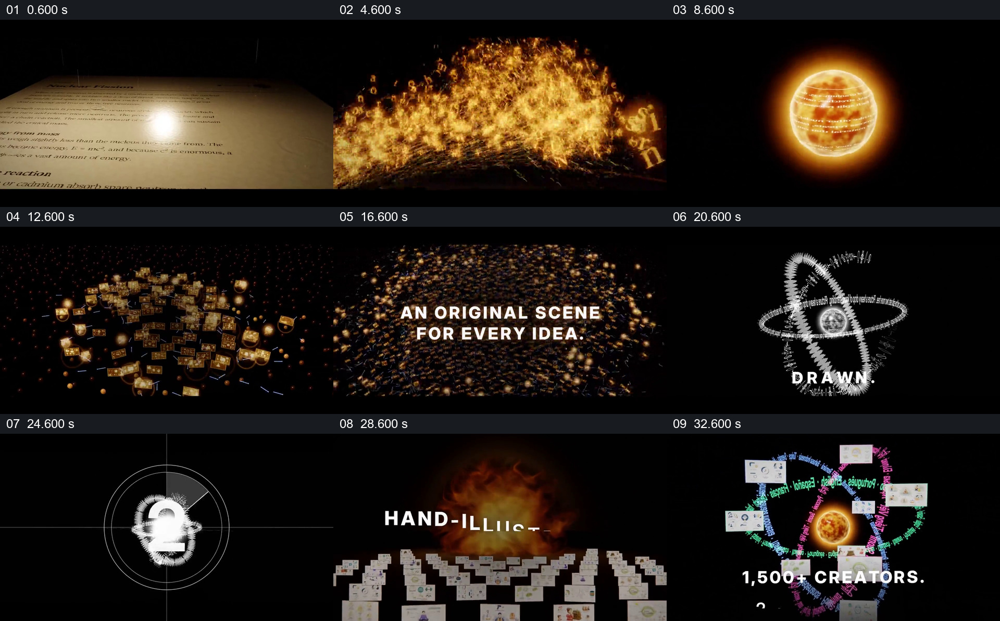

# 从纸面文字到粒子，再让场景围绕同一视觉核心

- 作品：案例 063（库内案例）。
- 原片范围：00:00–36.000 秒；[原片](../video.mp4)｜[片段](c01.mp4)。含起点、不含终点。
- 观察方式：查看全片 64 格与本卡九宫格；未独立原速连续观看或听审，数据、产品宣称及迁移未核实。

## 原画面具体怎样设计

黑暗中一束亮点落在铺满英文文字的纸面；金色字母和光粒在纸面上方聚集，成为发光球体。黑场中出现“FISSION”，球体随后分裂，许多金色小画面与亮点散布在空间；中心文字写“AN ORIGINAL SCENE FOR EVERY IDEA”，小画面仍构成背景，暗示一个材料带出多个场景。

“FUSION”之后视觉转成白色轨道，围绕中央球依次出现 WRITTEN、VOICED、DRAWN；轨道内出现倒数，画面变成火光背景及逐行排列的白色手绘解释页面，接着抽出具体白板和人物示例。最后彩色多语言文字构成轨道，多张小样例围绕金色球体组合，字幕依次展示创作者、视频数量和画幅。片末品牌收束在片段之后。

## 为什么这样设计，好在哪里

纸面文字与金色粒子先让抽象的“材料被拆开”有可见来源；白色轨道再组织多个制作环节，最后回到真实可辨的样例，使视觉隐喻落到观众能想象的输出。球与轨道在前后反复出现，维持不同画面阶段的共同身份；若从炫目粒子直接跳到数字，没有中间的具体图解，就难以知道所说成果是什么。样例与数字属于宣传画面，真实性及功能未核实。

## 可直接使用的创意指令

选择可公开的原始材料，用其中真正有辨识度的文字、图形或形状形成持续母题；先让它分出对应多个内容单元，再以清楚的空间关系呈现组织过程，最后接入可辨认且有授权的实际成果。粒子、轨道和配色均可重设计，但要保留材料来源、多个结果以及再次组织的关系；说明抽象动画是隐喻，不能冒充实际处理流程。
