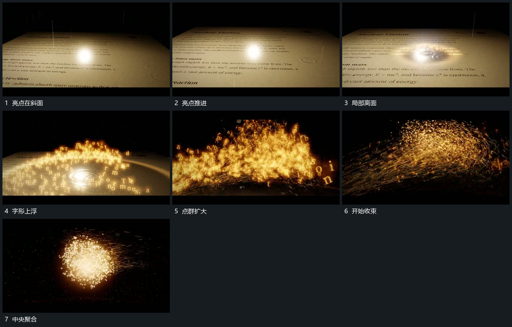

# 亮点沿斜面经过，字形上浮脱离后收成点群

## 运动指令

让亮点沿斜面经过，经过局部的字形向上浮起并离开平面。离面字形继续增加，形成有方向的点群；点群从长形收回中央，聚成紧凑主形，再交给短字组。

## 视频切片

[播放本机制的原片切片](m01.mp4)

覆盖分镜中“亮点在斜面”至“中央聚合”的连续过程，并保留邻近的前后衔接画面；原片中交叠发生的动作一并保留。

## 分镜过程

## 组合与调整

不继承字面主题，不推定粒子引擎。保留经过、离面、聚合的顺序。
