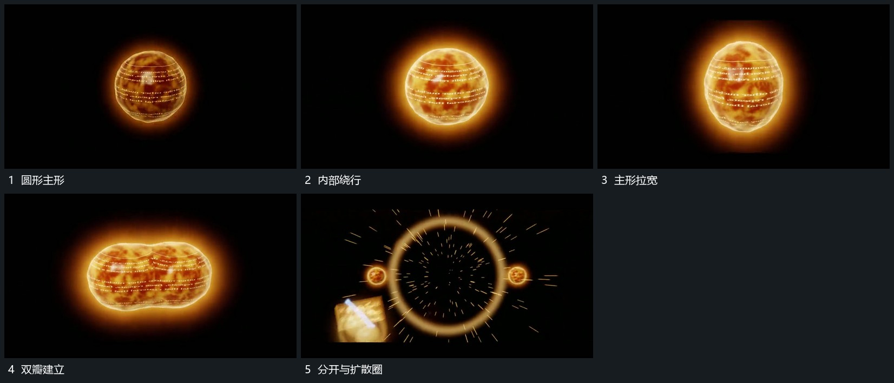

# 圆形主形内层绕行，压成双瓣后分开并追加扩散圈

## 运动指令

保留圆形主形，内部小字或短形沿轮廓绕行。主形逐渐拉宽，压出双瓣，再向两侧分开；分开位置接入扩散圈与短点，圈形向外扩开接给下一集合。

## 视频切片

[播放本机制的原片切片](m02.mp4)

覆盖分镜中“圆形主形”至“分开与扩散圈”的连续过程，并保留邻近的前后衔接画面；原片中交叠发生的动作一并保留。

## 分镜过程

## 组合与调整

采用可见形变，不推定原片物理模型。两瓣应来自同一主形。
