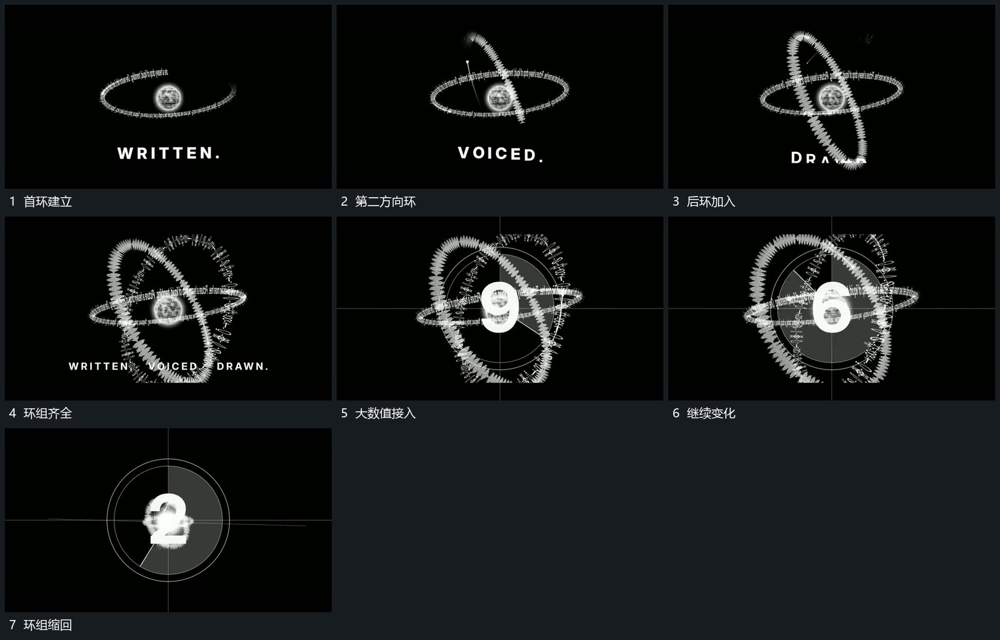

# 不同方向环先后建立，围同一中心转动，数值接续后缩回

## 运动指令

围同一中心先后建立不同方向的环，各环在自己的方向继续转动。环组完整后接入大数值与短字，数值逐次变化；末尾各环向共同中心缩回，中心接管下一动作。

## 视频切片

[播放本机制的原片切片](m04.mp4)

覆盖分镜中“首环建立”至“环组缩回”的连续过程，并保留邻近的前后衔接画面；原片中交叠发生的动作一并保留。

## 分镜过程

## 组合与调整

环之间可交叠，但中心应稳定，缩回过程不能各自飞向无关方向。
