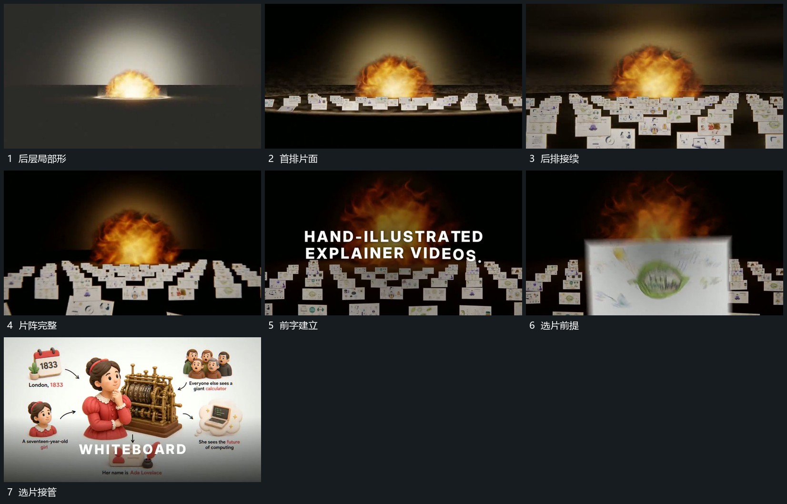

# 多排片面从近到远立起，镜头前移后选片接管

## 运动指令

从局部膨胀形前接入多排片面，近排先建立，后排向远处接续。镜头在片阵中前移，选出一张片前提放大，外围片退出主要区域，由选片接管完整画面。

## 视频切片

[播放本机制的原片切片](m05.mp4)

覆盖分镜中“后层局部形”至“选片接管”的连续过程，并保留邻近的前后衔接画面；原片中交叠发生的动作一并保留。

## 分镜过程

## 组合与调整

选片必须能追溯到片阵，不在推近途中换成无关材料。
