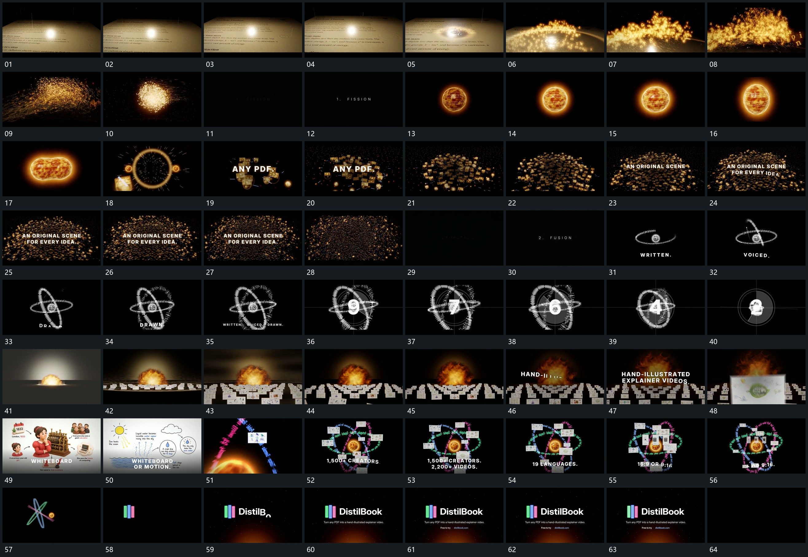

# 063｜原片运动总览

[观看完整原片](video.mp4)

## 运动总览

开头 亮点沿斜面经过，字形上浮脱离后收成点群 让亮点沿斜面经过，局部字形离开片面上浮，聚成点群并收束到中央。短字组接管后 圆形主形内层绕行，压成双瓣后分开并追加扩散圈 建立一个圆形主形，内字沿轮廓绕行，主形压成双瓣并分开，圈形反馈扩散。

中段 小片从少到多铺成弧形空间，前字保持，外围继续经过 将小片从少到多铺成有远近的弧形群组，前字保持，外围继续经过。不同方向环先后建立，围同一中心转动，数值接续后缩回 先后建立不同方向的环，围绕同一中心转动，短字与大数值接续变化，最后环组缩回。随后 多排片面从近到远立起，镜头前移后选片接管 从局部膨胀形接入多排片面，片面从近到远立起，镜头前移，选片放大接管。

后段复用 不同方向环先后建立，围同一中心转动，数值接续后缩回 的绕行关系，在环之间错开补小片，横片与竖片短暂接替。多环与小片缩向中央，短形接管后字组补齐 将完整环组缩向中央，几段短形接管，再接主字、附属行与底条，结束保持。

## 完整运动段落

以下按原片中的出现顺序引用。建立、内部发展及完成反馈放在同一段中；同时发生的局部动作与运镜写在同一份指令里。不同段之间可以是连续接管，也可以是直接切换，不能仅凭条目相邻认定可直接拼接。重复出现的同类运动采用一次连续代表范围，切片不以逐段无缝覆盖整片为目标。

1. [亮点沿斜面经过，字形上浮脱离后收成点群](mechanisms/m01.md)：亮点先经过，字形随后离面聚合

2. [圆形主形内层绕行，压成双瓣后分开并追加扩散圈](mechanisms/m02.md)：内部先活动，主形再分开

3. [小片从少到多铺成弧形空间，前字保持，外围继续经过](mechanisms/m03.md)：外围增长，前字稳定

4. [不同方向环先后建立，围同一中心转动，数值接续后缩回](mechanisms/m04.md)：环错峰建立，共用中心

5. [多排片面从近到远立起，镜头前移后选片接管](mechanisms/m05.md)：片阵先建立，镜头再选择

6. [多环与小片缩向中央，短形接管后字组补齐](mechanisms/m06.md)：整组先收束，字组后到

切片保留起始准备、必要内部停顿和完成或明确交接；首尾省略无新发展的等待，持续运动不要求人为停住。以上基于真实源帧序列和重点边界核对，不等同于全片连续声画审片。

## 完整64宫格

