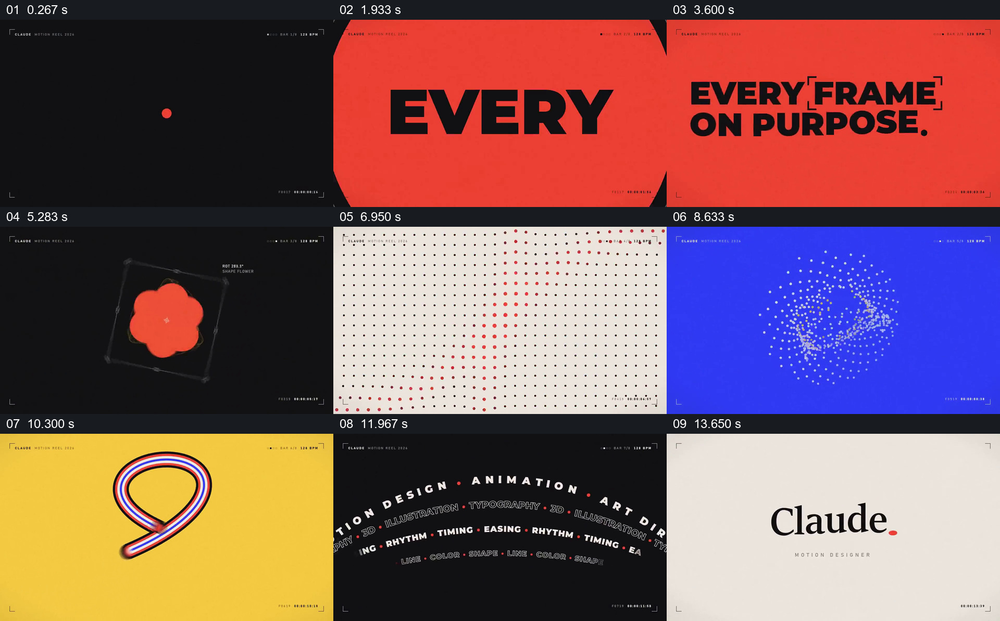

# 让红点、色块和基本几何贯穿一组不同形式的运动展示

- 作品：案例 108《几何、粒子与色块组合》（库内索引名称）。
- 原片范围：00:00.000–00:15.061，含起点、不含终点；[完整原片](../video.mp4)｜[本卡片段](../video.mp4)。
- 范围依据：从黑底红点和开篇文字，到几组几何实验、文字圆环和署名；整片保留。
- 观察方式与未确认范围：查看整片 64 帧总览和本卡分镜。未独立完成连续原速观看与听审；抽帧之间的运动、停顿与声音配合待复核。画面中的界面、数字与说明是作品呈现，未经额外核实；设计价值为基于画面的分析。

## 原画面具体怎样设计

黑色背景中央一个红点，后续抽帧出现多个红点围成圆；画面转为红色，大号黑字先显示 EVERY，最终组成“EVERY FRAME ON PURPOSE”。随后回到黑底，圆形、圆角方形、三角形与花形轮廓出现在中央，并配有细框、角点和小字。

浅色背景上整齐分布的小点组成阵列，部分红点连成弯曲形状；蓝底画面中白色和黄色小点形成球状与环状结构，再显示细线立方体。黄色背景下，一条红蓝白相间的线条形成环形；黑底上多行设计词语又形成圆弧与圆环。

最后浅底出现 Claude 署名和红点。小号边角标记和不同位置的红点贯穿多个段落，但抽帧不能确定每个对象是否连续变形或与音乐精确同步。

## 为什么这样设计，好在哪里

红点从开头的视觉焦点扩展为文字强调、点阵中的对比色与最后的署名点，帮助观众把不同实验归为一组。大面积的黑、红、蓝、黄和浅色背景把每一类形状分开，让细小点阵、线条和字形各自保持清晰；结尾再缩回署名，形成从简单元素到多样展示再收束的结构。

这是一组作品中的画面观察，不证明具体软件、生成机制或节拍参数。

## 可直接使用的创意指令

挑选一个简单元素和少量高对比色，先单独建立它，再把它放进几个确有差异的表现中：如字形、重复阵列、粒子空间或线条。每一段只保留一个主要观看对象，让色彩或形状在段落间建立关联，最后回到起始元素或签名。

形状、配色和媒介可重新设计；若运动连续性或节奏是关键，必须通过连续播放实际核对，而不能依据静帧补写。

本方法尚未在新题材中实测。
