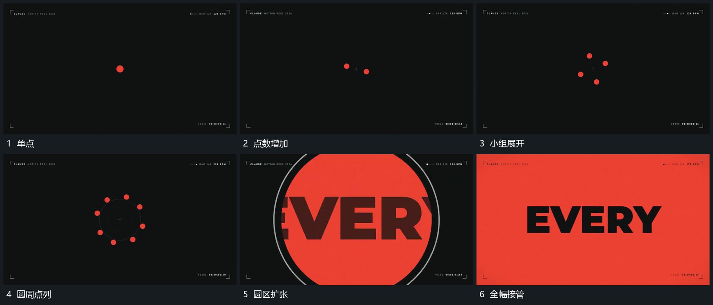

# 单点逐次增加成圈后圆区放大覆盖

## 运动指令

先保留中央单点，再在其周围逐次增加点，点从近处向圆周分布并形成完整圈。圆区从圈内向外扩大，字行在扩张中露出，圆边界越界后完成全幅接管。

## 视频切片

[播放本机制的原片切片](m01.mp4)

覆盖分镜中“单点”至“全幅接管”的连续过程，并保留邻近的前后衔接画面；原片中交叠发生的动作一并保留。

## 分镜过程

## 组合与调整

点数按需要选择；由点到圈再到覆盖的尺度变化连续，不在中间重置中心。
