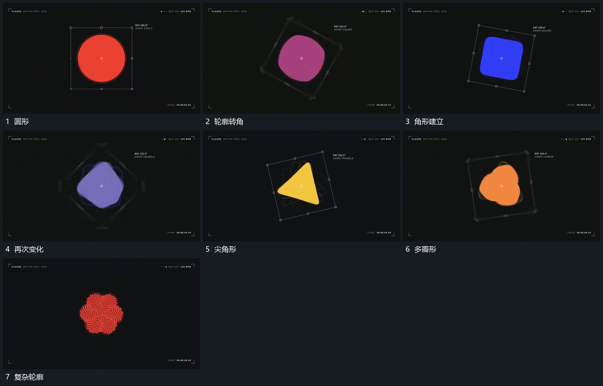

# 中央平面形转角中连续改变轮廓

## 运动指令

保留中央形的中心，整体转角中让外轮廓逐步由圆滑变为带角，再增减角点形成下一形。外框随中心形转角保持包围关系，内部范围不凭空跳到别处，最后外框退去只留完整新轮廓。

## 视频切片

[播放本机制的原片切片](m03.mp4)

覆盖分镜中“圆形”至“复杂轮廓”的连续过程，并保留邻近的前后衔接画面；原片中交叠发生的动作一并保留。

## 分镜过程

## 组合与调整

不反推变形算法；新片选择能够连续实现的形态与中间轮廓。
