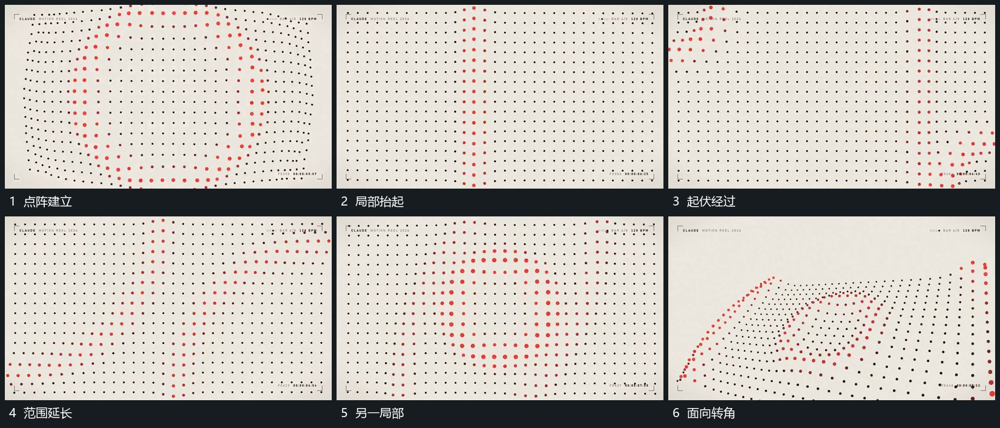

# 稳定点阵的局部起伏沿面经过

## 运动指令

保持点阵基本格位，局部点先抬高或偏移，邻近格位随后接上，形成沿面的起伏。已经过局部逐步回到较平状态，另一处继续发起；取景可少量转角，但点阵仍是一张连续面。

## 视频切片

[播放本机制的原片切片](m04.mp4)

覆盖分镜中“点阵建立”至“面向转角”的连续过程，并保留邻近的前后衔接画面；原片中交叠发生的动作一并保留。

## 分镜过程

## 组合与调整

波幅按需要调整；不能用随机散点代替原格位上的连续位移。
