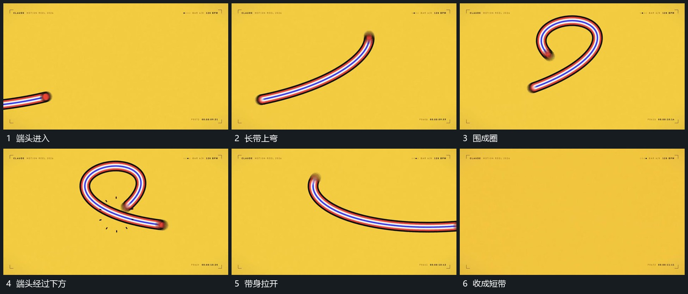

# 长带端部沿弯路经过围成圈再回收短带

## 运动指令

长带端头从侧边进入，沿向上再向内的弯路前进，带身随端头延长并围成圈。端头继续经过下方时圈被拉开，后端逐步跟进，最终回收成较短带，曲率减小并保持。

## 视频切片

[播放本机制的原片切片](m06.mp4)

覆盖分镜中“端头进入”至“收成短带”的连续过程，并保留邻近的前后衔接画面；原片中交叠发生的动作一并保留。

## 分镜过程

## 组合与调整

路径和长度共同控制；带身要跟随端头的经过历史，不每帧跳成另一条曲线。
