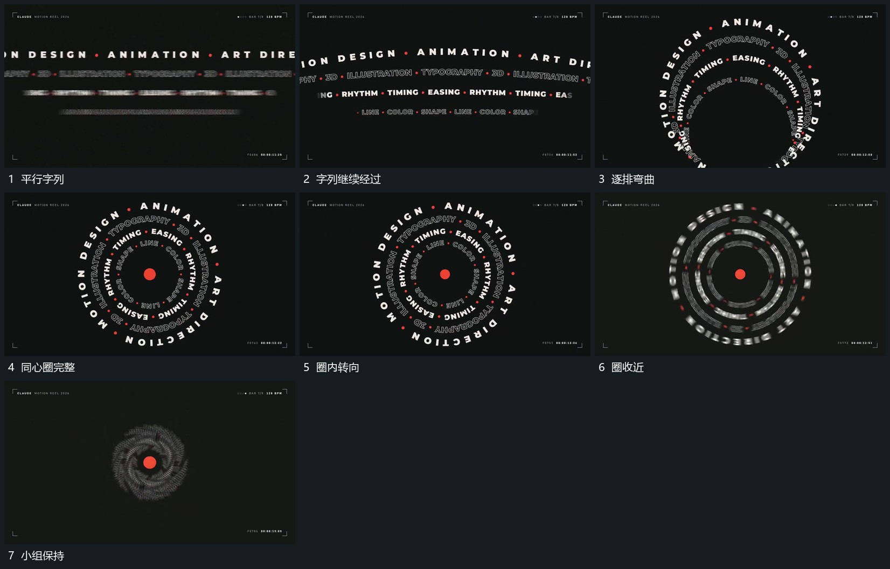

# 多排字列弯成同心圈后转动收近

## 运动指令

多排字列先横向经过，随后各排逐步弯向同一中心，形成不同半径的字圈。字圈继续沿各自圆周转动，中心点保持；完成后各圈收小半径并退弱，最后只留下较小中央组。

## 视频切片

[播放本机制的原片切片](m07.mp4)

覆盖分镜中“平行字列”至“小组保持”的连续过程，并保留邻近的前后衔接画面；原片中交叠发生的动作一并保留。

## 分镜过程

## 组合与调整

可用小片列代替文字；不同排沿各自半径转动，避免合为一张静态圆形图片。
