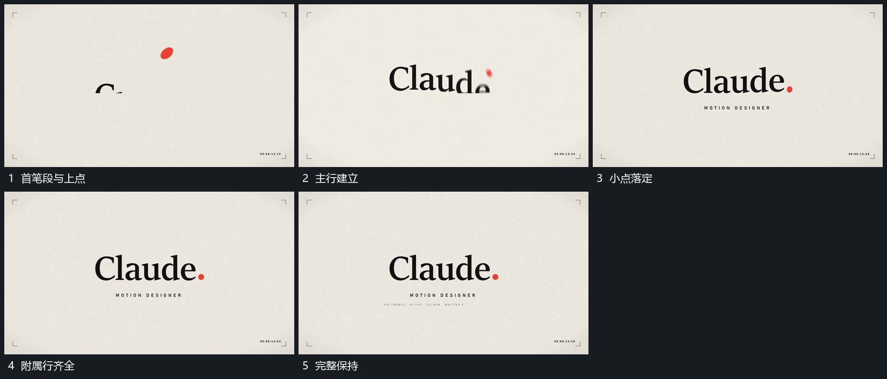

# 主行逐段建立上方小点落到行末

## 运动指令

中央主行从首笔段开始逐步建立，小点在上方独立下落并向行末靠近。主行完整时小点落定在末端，附属小行再从下方补齐；外围残留层退去，整组保持。

## 视频切片

[播放本机制的原片切片](m08.mp4)

覆盖分镜中“首笔段与上点”至“完整保持”的连续过程，并保留邻近的前后衔接画面；原片中交叠发生的动作一并保留。

## 分镜过程

## 组合与调整

可把落点换成主形某个局部，保留小点与前一段残留的来源关系。
