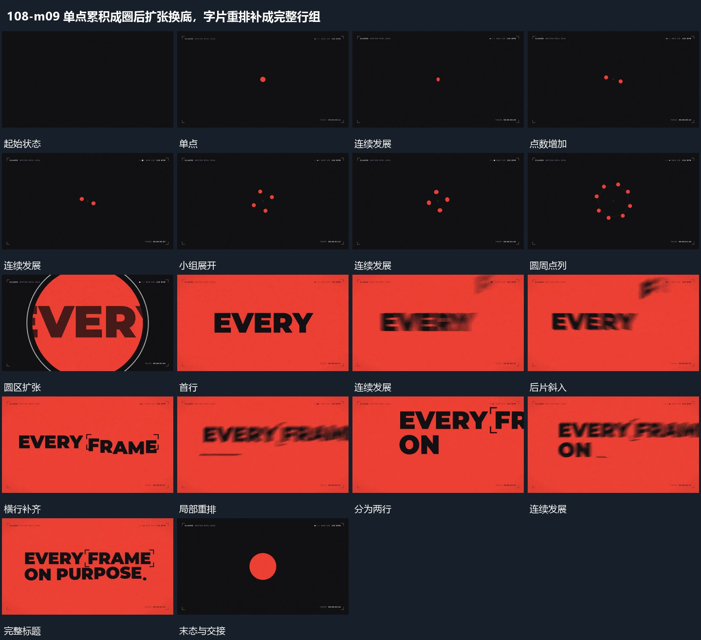

# 单点累积成圈后扩张换底，字片重排补成完整行组

## 运动指令

单点逐次增加成为环状集合，后层圆区迅速扩张接管；字片从外侧移入并重排，多行依次补齐，最后收回中央小点作为下一段接点。

1. **单点逐次增加成圈后圆区放大覆盖**

先保留中央单点，再在其周围逐次增加点，点从近处向圆周分布并形成完整圈。圆区从圈内向外扩大，字行在扩张中露出，圆边界越界后完成全幅接管。

2. **字片移入重排后分行接成完整标题**

首行保持时让后续字片从上方或侧方带小转角进入，接近目标位置后转正。补齐过程中已有字略调整间距，随后整行重排为上下两行，下方短线接上，最终各片停止位移。

整段结束：完整多行标题稳定 保留必要落稳与交接，中间已建立的参照沿用到下一步骤。

## 视频切片

[播放本机制的原片切片](m09.mp4)

保留起始准备、连续发展和完成或明确交接；首尾按本段运动范围裁切，不拼接、不变速。相连的小动作合为同一完整段落。

## 分镜过程

## 组合与调整

单点逐次增加成为环状集合，后层圆区迅速扩张接管；字片从外侧移入并重排，多行依次补齐，最后收回中央小点作为下一段接点。 复用时可调整元素数量、幅度和相对节奏，保留上述进入、交叠与完成关系；不直接沿用原片题材或时长。

点数按需要选择；由点到圈再到覆盖的尺度变化连续，不在中间重置中心。

替换为几何短片也可；每片有明确目标位置，不用全行抖动代替重排。
