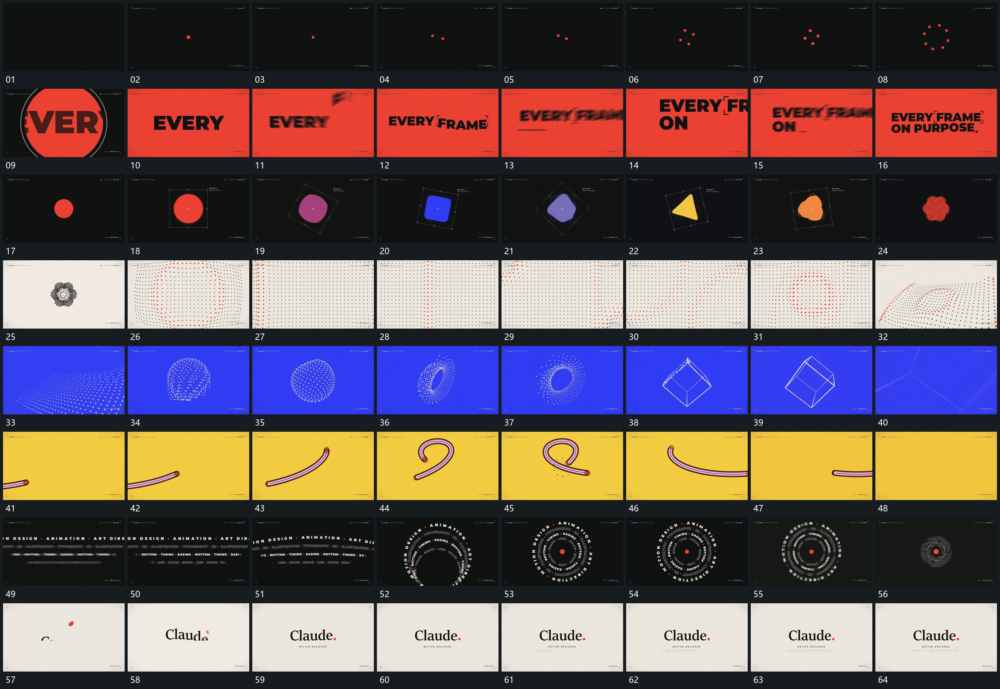

# 108｜原片运动总览

[观看完整原片](video.mp4)

## 运动总览

全片以单点逐次增加成圈后圆区放大覆盖从单点增加成圈，再扩大覆盖并接上字行；字片移入重排后分行接成完整标题把字片移入、重排和分行接成完整前层。其后中央平面形转角中连续改变轮廓让中央平面形持续转角并连续改变轮廓。

点阵段用稳定点阵的局部起伏沿面经过保持格位关系而让局部起伏沿阵列经过；接着点面收成球组打开中间再向边线收拢由点面收成立体球组、打开中心形成环，再向边线收拢。后段长带端部沿弯路经过围成圈再回收短带让长带端部沿弯曲路线经过并回收为短带，多排字列弯成同心圈后转动收近把多排字列弯成同心圈并收近。结尾主行逐段建立上方小点落到行末建立主行，让上方小点落到行末。

## 完整运动段落

以下按原片中的出现顺序引用。建立、内部发展及完成反馈放在同一段中；同时发生的局部动作与运镜写在同一份指令里。不同段之间可以是连续接管，也可以是直接切换，不能仅凭条目相邻认定可直接拼接。重复出现的同类运动采用一次连续代表范围，切片不以逐段无缝覆盖整片为目标。

1. [单点累积成圈后扩张换底，字片重排补成完整行组](mechanisms/m09.md)：单点逐次增加成为环状集合，后层圆区迅速扩张接管；字片从外侧移入并重排，多行依次补齐，最后收回中央小点作为下一段接点。

2. [中央平面形转角中连续改变轮廓](mechanisms/m03.md)：轮廓变化和转角交叠

3. [稳定点阵的局部起伏沿面经过](mechanisms/m04.md)：局部位移沿面传递

4. [点面收成球组打开中间再向边线收拢](mechanisms/m05.md)：收集成体再重排到边

5. [长带端部沿弯路经过围成圈再回收短带](mechanisms/m06.md)：端头前进带身跟随回收

6. [多排字列弯成同心圈后转动收近](mechanisms/m07.md)：字列弯曲绕行收拢

7. [主行逐段建立上方小点落到行末](mechanisms/m08.md)：主行建立后小点落定

切片保留起始准备、必要内部停顿和完成或明确交接；首尾省略无新发展的等待，持续运动不要求人为停住。以上基于真实源帧序列和重点边界核对，不等同于全片连续声画审片。

## 完整64宫格

