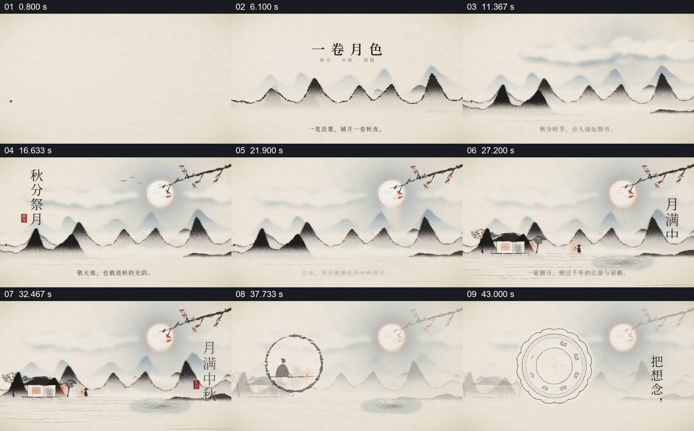

# 让同一轮月亮贯穿画卷、节令和想念的收束

- 作品：案例 079《一卷月色与中秋思念》（本次概括）。
- 原片范围：00:00.000–00:47.485，含起点、不含终点；[完整原片](../video.mp4)｜[本卡片段](../video.mp4)。
- 观察方式：依据约每秒一次的真实源帧观察，未连续原速观看或听审；声音、语气与完整播放节奏未确认。

## 原画面具体怎样设计

浅色纸面上先有一点墨迹，山线逐步展开，远近山峦、雾气和月亮依次显现；右上枝条与花朵伸入，竖排“秋分祭月”等文字落在山水之间。后续小屋、人物与“月满中秋”加入原有山水；圆形墨线圈住人物后淡去，画面中央又画出层层圆形纹样，旁边出现“把想念，带回身边”。月亮和远山仍在背景中。

## 为什么这样设计，好在哪里

月亮始终是稳定的观看锚点，山水和文字逐渐加入，使节令和思念发生在同一幅画卷中；人物被圈入与最后圆形纹样的接续，让情感由远景转到可辨的局部。节俗内容是片中文字，未独立考证。

以上为依据画面的分析，非作者自述；预期观看效果未经观众测试。

## 可直接使用的创意指令

设计从节令景象转向个人情感的画面时，先建立一个能够贯穿全段的自然物或空间，逐步加入与主题有关的环境、人物和文字；让后段的局部形状呼应前面已经出现的对象，再用简短文字收束。历史习俗和文字内容需据可靠资料核实，美术形式与节奏可按主题调整。
