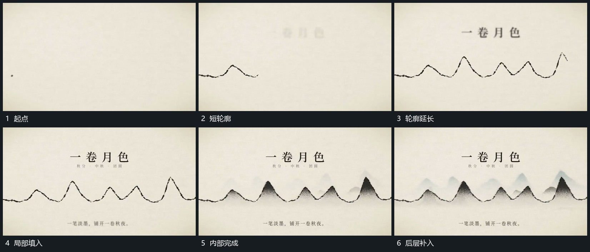

# 起伏轮廓横向延长再逐层填入内部

## 运动指令

从一侧短线开始向另一侧延长，线条依次经过高低起伏。轮廓建立后内部先在局部展开，再沿同一范围补齐；后方较淡的起伏片层随后加入，形成前后不同高度的连续层。

## 视频切片

[播放本机制的原片切片](m01.mp4)

覆盖分镜中“起点”至“后层补入”的连续过程，并保留邻近的前后衔接画面；原片中交叠发生的动作一并保留。

## 分镜过程

## 组合与调整

轮廓可换任意曲线；先建立外边界再增加内部，不把填充与描线全部同时完成。
