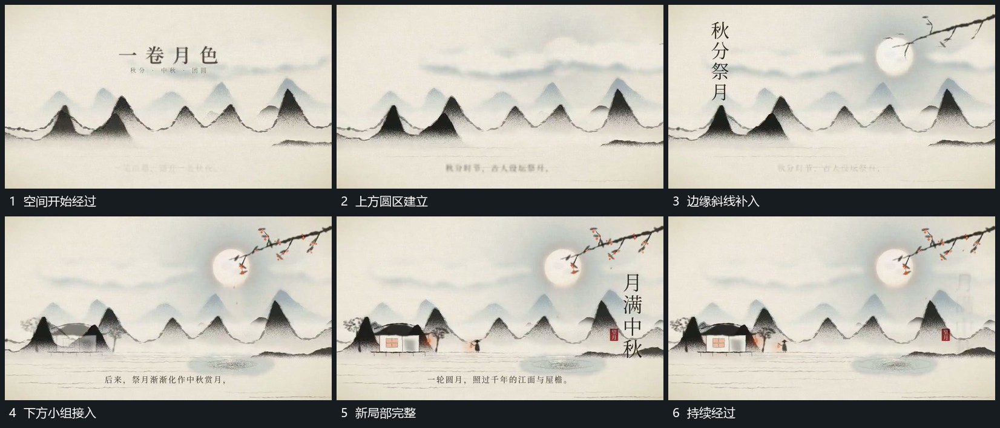

# 长条空间持续横移新局部从边缘接入

## 运动指令

让长条空间持续横向经过画面，前层和后层以不同幅度移动。上方圆区、斜线与下方小组在接近取景范围时分次建立，加入后与所属层一起经过；底部短行可以原位接替，不跟随全空间漂走。

## 视频切片

[播放本机制的原片切片](m02.mp4)

覆盖分镜中“空间开始经过”至“持续经过”的连续过程，并保留邻近的前后衔接画面；原片中交叠发生的动作一并保留。

## 分镜过程

## 组合与调整

适合连续展开，横移方向保持一致；新增局部在原空间内接入，避免每段重新起一幅背景。
