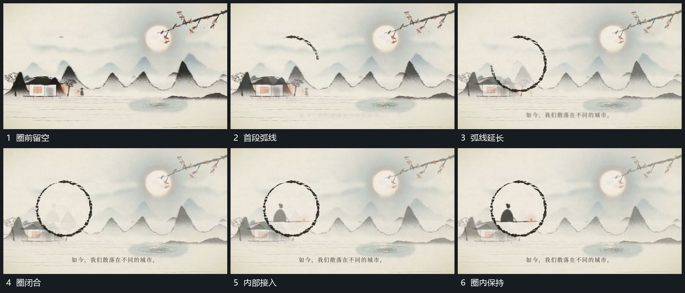

# 圆周逐段描出后圈内小形接入

## 运动指令

从圆周一处开始延长弧线，沿边界绕行并逐步闭合成圈。圈闭合时内部小形由弱到清楚接入，圆圈和小形保持共同位置，后层继续经过。完成后两者一起退弱，接下一局部。

## 视频切片

[播放本机制的原片切片](m04.mp4)

覆盖分镜中“圈前留空”至“圈内保持”的连续过程，并保留邻近的前后衔接画面；原片中交叠发生的动作一并保留。

## 分镜过程

## 组合与调整

圈可改变尺寸，内部接入不要早于包围可辨；保留圆边界作为后续同心运动的参照。
