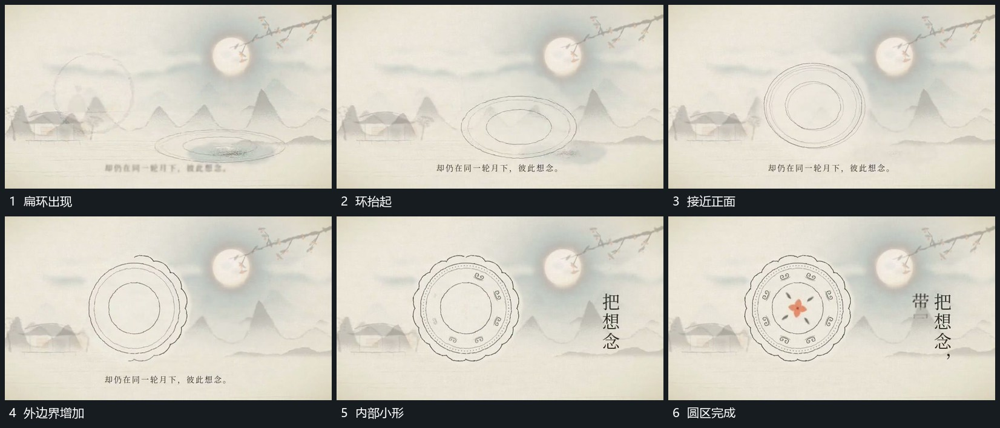

# 扁环从下方抬起转正再补外圈与内部

## 运动指令

在下方先建立窄扁的同心环，整体抬起并逐步转向正面，环的投影由扁到圆。稳定后沿外缘补出起伏边界，内圈小形随后逐项出现，最后中央小形加入；后层仍保留同一横移空间。

## 视频切片

[播放本机制的原片切片](m05.mp4)

覆盖分镜中“扁环出现”至“圆区完成”的连续过程，并保留邻近的前后衔接画面；原片中交叠发生的动作一并保留。

## 分镜过程

## 组合与调整

转角过程中内部图样随环一起变化；完成正面状态后再补细部，避免刚出现就同时铺满所有层。
