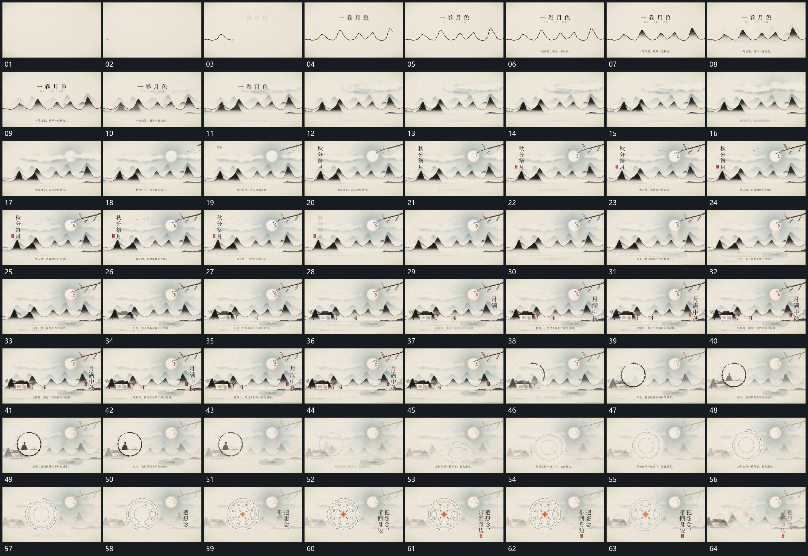

# 079｜原片运动总览

[观看完整原片](video.mp4)

## 运动总览

全片先用起伏轮廓横向延长再逐层填入内部延长起伏轮廓并从轮廓内部逐层展开，继而长条空间持续横移新局部从边缘接入持续横移，同一长条空间不断接入新局部。其间竖行字分项建立保持后退弱接替让竖行字分项建立、保持再退弱，后层横移不中断。

新局部接入后，圆周逐段描出后圈内小形接入沿圆周描出完整圈并在圈内补入小形；圈退弱后，扁环从下方抬起转正再补外圈与内部从下方扁环开始抬起、转正、补外圈与内部小形。最后继续复用竖行字分项建立保持后退弱接替建立并列竖行，原长条空间仍在经过。

## 完整运动段落

以下按原片中的出现顺序引用。建立、内部发展及完成反馈放在同一段中；同时发生的局部动作与运镜写在同一份指令里。不同段之间可以是连续接管，也可以是直接切换，不能仅凭条目相邻认定可直接拼接。重复出现的同类运动采用一次连续代表范围，切片不以逐段无缝覆盖整片为目标。

1. [起伏轮廓横向延长再逐层填入内部](mechanisms/m01.md)：先延线后内部展开

2. [沿长条空间持续横移，新局部与竖行文字从边缘接续](mechanisms/m06.md)：整个长空间沿横向持续展开，新局部从边缘进入；竖行字分项显出并保持，在继续移动时退弱，下一组接替。

3. [圆周逐段描出后圈内小形接入](mechanisms/m04.md)：先描圈后内部建立

4. [扁环从下方抬起转正再补外圈与内部](mechanisms/m05.md)：升起转角后逐层补入

切片保留起始准备、必要内部停顿和完成或明确交接；首尾省略无新发展的等待，持续运动不要求人为停住。以上基于真实源帧序列和重点边界核对，不等同于全片连续声画审片。

## 完整64宫格

