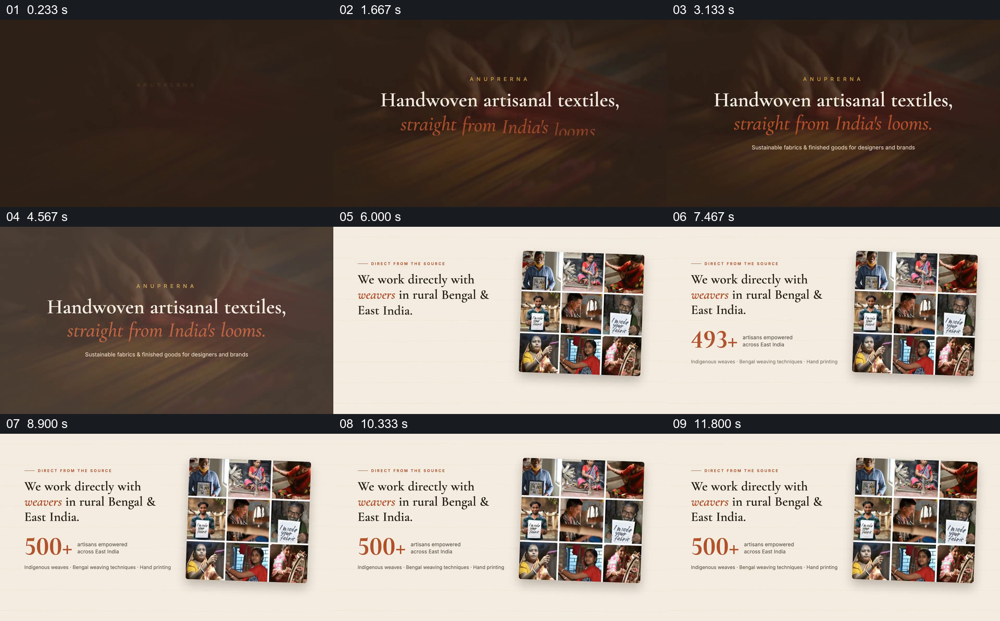

# 从品牌承诺切到织工照片墙，让来源与人并置

- 作品：案例 014《织工、面料与产品信息》（库内索引名）。
- 原片范围：00:00.000–00:13.000；[完整原片](../video.mp4)｜[本卡片段](c01.mp4)，片段起点对应源时间 0.000 秒。
- 边界依据：先在深色布料底上展示品牌文字，再以织工影像、地区和规模形成来源画面。 之后进入下一项独立表达。
- 观察方式：核看全片 64 帧总览及本卡九宫格；原片无音轨，未独立连续原速观看。广告主张未独立查证，迁移效果未实测。

## 原画面具体怎样设计

深棕底上隐约可见织布背景，中央先后显示品牌名和“Handwoven artisanal textiles, straight from India’s looms.”；浅色副标题位于下方。随后换米色背景，左侧文字说明与孟加拉及东印度的织工直接合作，右侧九张人物、手部和织机照片排列成一张网格。左下计数逐步显示至“500+”，下方补充工艺词，照片墙持续保留。

## 为什么这样设计，好在哪里

标题先给出产品身份，下一画面让织工和工作过程与产地陈述同时可见；数字位于照片左侧而非遮住人物，使规模与个体并置。直接合作、人数及产地是广告中的说法，仅凭拼图不能独立证明。

## 完整照排指令

以[完整原片](../video.mp4)的 0–13 秒为准。画幅 1280×720，源帧率 30/1。以下拍点为抽帧定位，位置按画幅百分比取近似值。

### 用料

【织物底图】取有真实纹理的暗棕布面。【织工照片组】备约十二幅彩色实拍，人物、织机和织物确与【产地声明】相关。备【品牌眉字】【承诺首行】【承诺次行】【承诺附注】【产地眉字】【织工总数】【数字单位】【统计小注】【邻段材料图】【邻段材料文字】。织工总数及产地附可打开的记录、统计日期和对象范围，未证实部分不写进地名或数字。

### 按源时刻摆放

1. **0.000–约 4.800 秒。** 深棕【织物底图】满铺，纹理和斜向褶皱降至低反差。上中用小金色疏排【品牌眉字】，以下依次建中轴两行衬线。【承诺首行】偏暖白、较大，【承诺次行】赭金斜体，同宽或略窄。【承诺附注】为后出的细浅字，近一行。背景可用布面静图缓移，文字跟屏幕。
2. **约 4.800–8.500 秒。** 硬切暖奶白。左栏 x8% 起用小赭色【产地眉字】和较大的深棕衬线【产地声明】，分两至三行。右栏给错胶片格的【织工照片组】，三列约四行，微斜、白格缝很窄，有头肩、织布机、手工和成材。照片须一眼读出人物与工作，不用一批成品照代替整墙。
3. **约 8.500–11.400 秒。** 照片墙、产地声明留在原位，左下【织工总数】用赭红偏大衬线，从低值上升，落稳后标出【数字单位】及细小深色【统计小注】，字与数字紧贴。窗阵自出现至切出继续保留，原片观察到以照片为主，允许定格或整墙微移；使用动态时从到位至退出保持连贯，且每窗都属于同一产地或清楚标明例外。
4. **约 11.400–13.000 秒。** 奶白版让位深棕面，左到右可见【邻段材料图】的鲜亮小横幅和各自下面的【邻段材料文字】，留缝。按 13.000 秒切出。只采用承诺与来源时，在后段材料卡接管前结束。

### 局部采用

只有可查产地和同源照片时，可用约 4.800–11.400 秒。缺统计时保留照片墙和产地文字，省略计数位置。

### 验证状态

已对照原片逐秒画序并读回。重点检查暗布上的中心排印、暖白版两栏、照片持续时数字增长及三卡切出。精确转折帧、原速听看与换料试摆待核。
