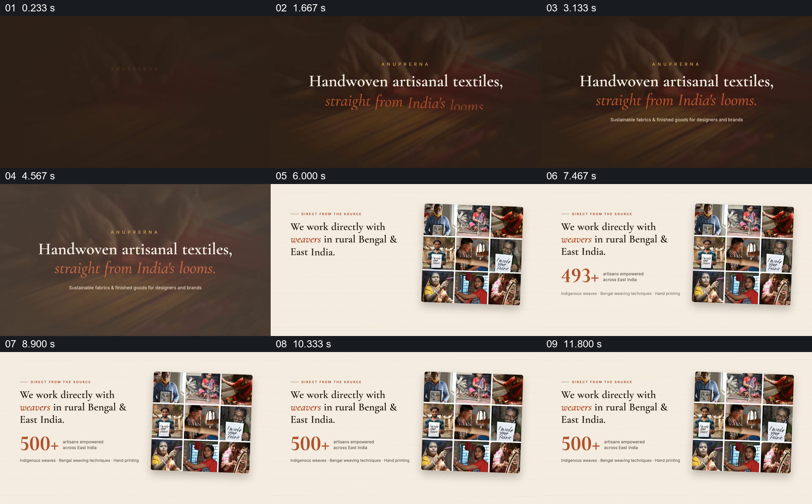

# 从品牌承诺切到织工照片墙，让来源与人并置

- 作品：案例 014《织工、面料与产品信息》（库内索引名）。
- 原片范围：00:00.000–00:13.000；[完整原片](../video.mp4)｜[本卡片段](c01.mp4)，片段起点对应源时间 0.000 秒。
- 边界依据：先在深色布料底上展示品牌文字，再以织工影像、地区和规模形成来源画面。 之后进入下一项独立表达。
- 观察方式：核看全片 64 帧总览及本卡九宫格；原片无音轨，未独立连续原速观看。广告主张未独立查证，迁移效果未实测。

## 原画面具体怎样设计

深棕底上隐约可见织布背景，中央先后显示品牌名和“Handwoven artisanal textiles, straight from India’s looms.”；浅色副标题位于下方。随后换米色背景，左侧文字说明与孟加拉及东印度的织工直接合作，右侧九张人物、手部和织机照片排列成一张网格。左下计数逐步显示至“500+”，下方补充工艺词，照片墙持续保留。

## 为什么这样设计，好在哪里

标题先给出产品身份，下一画面让织工和工作过程与产地陈述同时可见；数字位于照片左侧而非遮住人物，使规模与个体并置。直接合作、人数及产地是广告中的说法，仅凭拼图不能独立证明。

## 可直接使用的创意指令

有真实来源资料时，先用简洁定位建立产品，再并置制造者、工作过程和经核实的地区或规模。让具体人物留在画面中，数字和说明占据独立阅读区；主体、拼图数量和色彩可调整，保留抽象品牌与具体来源的联系。
