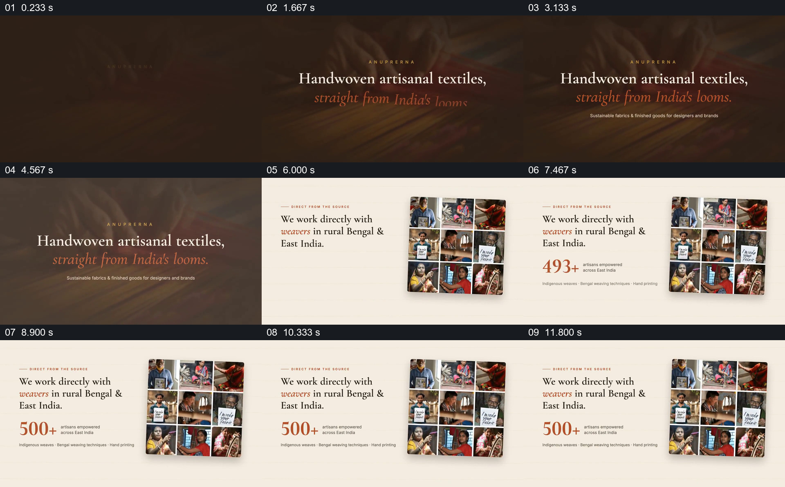

# 从一句品牌主张落到织工照片墙

- 作品：案例 014《织物照片与品牌叙事》（索引名称）。
- 原片范围：00:00.000–00:13.000，含起点、不含终点；[完整原片](../video.mp4)｜[本卡片段](c01.mp4)。
- 观察方式：依据整片 64 宫格和约每秒一次的真实源帧观察，未连续原速观看；媒体探测显示原片没有音轨，因此没有可听审的原声。

## 原画面具体怎样设计

深棕色画面以“Handwoven artisanal textiles, straight from India’s looms.”作为居中标题。随后切到浅色页面：左边写直接与织工合作，旁边数字升至“500+”；右边是一组三行三列的织工、织机和手部工作照片。文字与照片维持左右分栏，数字建立后停留。

## 为什么这样设计，好在哪里

开场一句给出观看主题，随后相同版面把抽象的来源主张放到人物和工作情境旁。九格照片提供多样的工作视角，数字有单独位置；照片与数字不能独立证明合作人数或产地，片中主张本次未验证。

以上为依据画面的分析，非作者自述；预期观看效果未经观众测试。

## 可直接使用的创意指令

当介绍产品来源需要兼顾一句定位与具体生产者时，先用简短标题建立主题，再选择经许可、可溯源的工作者和工序照片，按统一大小组成图组，与关系说明并列。人数或地域必须配准确口径和来源；若证据不足，保留人物与工作场面的展示，不从照片数量推断规模。
