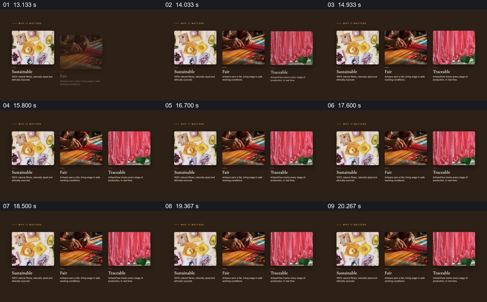

# 让三张材料与工艺照片分别承载三项价值

- 作品：案例 014《织工、面料与产品信息》（库内索引名）。
- 原片范围：00:13.000–00:21.000；[完整原片](../video.mp4)｜[本卡片段](c02.mp4)，片段起点对应源时间 13.000 秒。
- 边界依据：深色背景下三张图片依次并列，下面分别放可持续、公平、可追溯的短说明。 之后进入下一项独立表达。
- 观察方式：核看全片 64 帧总览及本卡九宫格；原片无音轨，未独立连续原速观看。广告主张未独立查证，迁移效果未实测。

## 原画面具体怎样设计

深棕底上方写“WHY IT MATTERS”。三张照片从左至右形成一排：天然材料和染色物、织布双手、悬挂的红色布料；每张下方有细短线、标题和较小说明，分别为 Sustainable、Fair、Traceable。首张先出现，之后两张补齐，最终三项保持同样大小和共同基线。

## 为什么这样设计，好在哪里

不同照片给每个抽象词一个具体观察对象，统一尺寸与排版说明它们是并列价值，而不是一个逐步变化的数字。每项说明仍需实际证据：织布照片本身不能证明公平工资或供应链可追溯。

## 完整照排指令

以[完整原片](../video.mp4)的 13–21 秒为准。画幅 1280×720，源帧率 30/1。以下拍点为抽帧定位，位置按画幅百分比取近似值。

### 用料

准备【价值图一】【价值图二】【价值图三】，分别呈现可观察的材料、工序或来源标记。原片以白底赭黄圆形物、暗底暖色织物、垂挂粉红布面形成三种色块。每幅备一行【价值名一】【价值名二】【价值名三】及对应二至三行【依据一】【依据二】【依据三】。若承诺环保、公平或可追溯，逐项附可打开的证书、供货记录或原始资料与适用范围。另备【邻拍数量】【邻拍标题】【邻拍布样】。

### 按源时刻摆放

1. **13.000–约 14.000 秒。** 深暖棕满底，左上 x8%、y12% 有一行小赭色眉字。画面中段先给左、中两个图文槽位，然后右侧【价值图三】补齐。图面等宽、近横幅，基线约 y55%，左右暗缝一致。左图【价值图一】以亮奶白和赭黄为主，中图【价值图二】显深色与成排暖织物，右图为高饱和粉色垂直纹理。
2. **约 14.000–约 20.000 秒。** 保留三窗。各自紧贴图下左齐用暖白衬线【价值名一】【价值名二】【价值名三】，其下小浅灰【依据一】【依据二】【依据三】，保持短行、低对比和整齐底部留白。三窗自入场后留到整体切出。原片画序中样图基本稳定，可用照片定格或轻运镜；若想用实际工序视频，至少连续覆盖其展示时间，并说明每窗与其价值的直接关系，不循环不可逆步骤。
3. **约 20.000–21.000 秒。** 深棕三图版退出。暖米色满底重建；左上大衬线【邻拍数量】接【邻拍标题】，可用斜赭字强调末句。下方初露几张【邻拍布样】。按 21.000 秒切出，若不承接其他布样选择则在暖底第一幅之前结束。

### 局部采用

只够两项可信价值时可取约 13–14 秒建立逻辑并留读两卡，空位收成两列。三项齐全时可独立取约 14–20 秒的稳定比较。

### 验证状态

已对照逐秒原片画序并读回，核对前两图先显、右列补入、三项图文留在同一阅读层，以及暖米色下一场切出。精确切点、原速听看和换料试摆待核。
