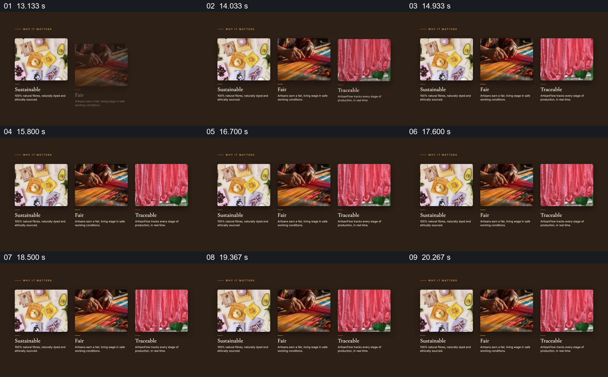

# 让三张材料与工艺照片分别承载三项价值

- 作品：案例 014《织工、面料与产品信息》（库内索引名）。
- 原片范围：00:13.000–00:21.000；[完整原片](../video.mp4)｜[本卡片段](c02.mp4)，片段起点对应源时间 13.000 秒。
- 边界依据：深色背景下三张图片依次并列，下面分别放可持续、公平、可追溯的短说明。 之后进入下一项独立表达。
- 观察方式：核看全片 64 帧总览及本卡九宫格；原片无音轨，未独立连续原速观看。广告主张未独立查证，迁移效果未实测。

## 原画面具体怎样设计

深棕底上方写“WHY IT MATTERS”。三张照片从左至右形成一排：天然材料和染色物、织布双手、悬挂的红色布料；每张下方有细短线、标题和较小说明，分别为 Sustainable、Fair、Traceable。首张先出现，之后两张补齐，最终三项保持同样大小和共同基线。

## 为什么这样设计，好在哪里

不同照片给每个抽象词一个具体观察对象，统一尺寸与排版说明它们是并列价值，而不是一个逐步变化的数字。每项说明仍需实际证据：织布照片本身不能证明公平工资或供应链可追溯。

## 可直接使用的创意指令

确认各项价值与真实材料的对应关系，每项选一张能说明其具体工作的图片，再用简短标题和可核实说明并列呈现。保持相同阅读层级、逐项建立后留出共同阅读时间；图数、顺序和颜色可变，不要把说明性画面当作认证证据。
