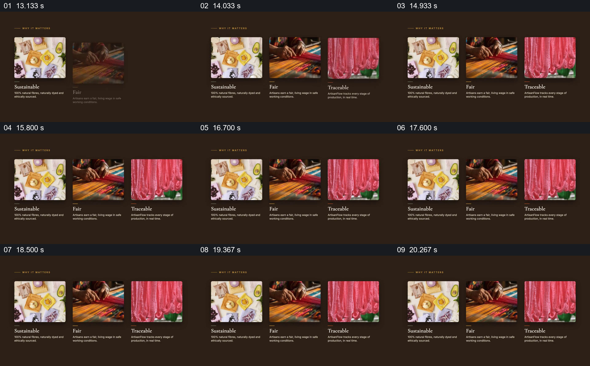

# 三张工艺照片分别承接三个价值词

- 作品：案例 014《织物照片与品牌叙事》（索引名称）。
- 原片范围：00:13.000–00:21.000，含起点、不含终点；[完整原片](../video.mp4)｜[本卡片段](c02.mp4)。
- 观察方式：依据整片 64 宫格和约每秒一次的真实源帧观察，未连续原速观看；媒体探测显示原片没有音轨，因此没有可听审的原声。

## 原画面具体怎样设计

深棕色背景中，三张照片依次排成横列，分别是材料、织造手部和布料画面；每张下方对应“Sustainable”“Fair”“Traceable”及短说明。三列完整出现后保持同一高度和间距。

## 为什么这样设计，好在哪里

各个价值词不是孤立堆叠，而与不同照片一一配对；同时保留三列使读者能比较它们的侧重点。图片能展示相关材料或动作，是否真正可持续、公平或可追溯仍要有独立证据。

以上为依据画面的分析，非作者自述；预期观看效果未经观众测试。

## 可直接使用的创意指令

当需要解释少量不同价值时，为每一项找到职责明确且有来源的照片，统一尺寸和阅读层级，按顺序建立标题与简短说明，并让完整组合同屏停留。每个价值主张需对应可核验的工艺、交易或追溯资料，照片只负责展示，不替代证明；窄画幅可以换行或分屏。
