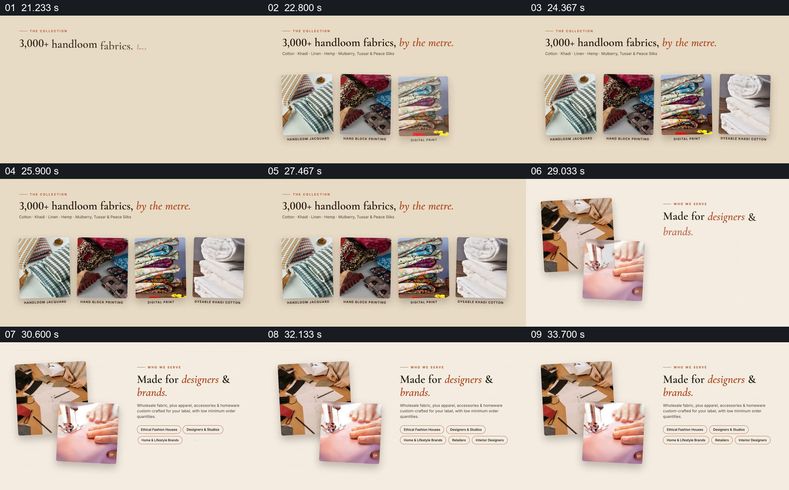

# 从布料类别排列转到设计者需求

- 作品：案例 014《织工、面料与产品信息》（库内索引名）。
- 原片范围：00:21.000–00:35.000；[完整原片](../video.mp4)｜[本卡片段](c03.mp4)，片段起点对应源时间 21.000 秒。
- 边界依据：多种布料照片和标签先并列，再以制作过程图片及用户类型解释使用场景。 之后进入下一项独立表达。
- 观察方式：核看全片 64 帧总览及本卡九宫格；原片无音轨，未独立连续原速观看。广告主张未独立查证，迁移效果未实测。

## 原画面具体怎样设计

浅米色画面顶部写“3,000+ handloom fabrics, by the metre”，下面相继排列四张不同面料照片，分别标示织造、手工印花、数码印花和可染棉布。页面随后交给新构图：左侧两张设计桌面、缝纫操作照片交叠，右侧写“Made for designers & brands”，下方逐步列出设计工作室、零售等对象标签。

## 为什么这样设计，好在哪里

第一组以相同卡片尺度帮助辨认面料差异；第二组换成制作过程和对象标签，把“有什么”转为“谁会用”。两组共同完成产品与用途的连接，但数量、工艺和客户类别都只是片中陈述。

## 可直接使用的创意指令

展示多类材料时，先以可比较的尺度并列实物和准确名称，之后用实际使用画面说明它们服务于什么任务，再给出有依据的对象分类。材料卡和使用场景可以重新设计；保留类别可辨认与用途有具体对象的关系。
