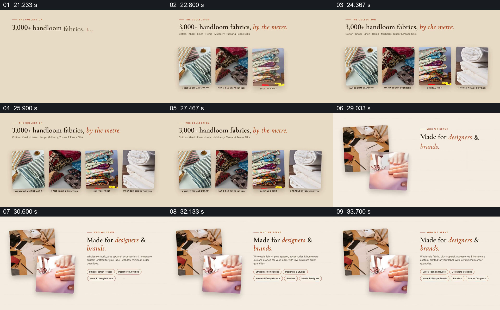

# 从布料类别排列转到设计者需求

- 作品：案例 014《织工、面料与产品信息》（库内索引名）。
- 原片范围：00:21.000–00:35.000；[完整原片](../video.mp4)｜[本卡片段](c03.mp4)，片段起点对应源时间 21.000 秒。
- 边界依据：多种布料照片和标签先并列，再以制作过程图片及用户类型解释使用场景。 之后进入下一项独立表达。
- 观察方式：核看全片 64 帧总览及本卡九宫格；原片无音轨，未独立连续原速观看。广告主张未独立查证，迁移效果未实测。

## 原画面具体怎样设计

浅米色画面顶部写“3,000+ handloom fabrics, by the metre”，下面相继排列四张不同面料照片，分别标示织造、手工印花、数码印花和可染棉布。页面随后交给新构图：左侧两张设计桌面、缝纫操作照片交叠，右侧写“Made for designers & brands”，下方逐步列出设计工作室、零售等对象标签。

## 为什么这样设计，好在哪里

第一组以相同卡片尺度帮助辨认面料差异；第二组换成制作过程和对象标签，把“有什么”转为“谁会用”。两组共同完成产品与用途的连接，但数量、工艺和客户类别都只是片中陈述。

## 完整照排指令

以[完整原片](../video.mp4)的 21–35 秒为准。画幅 1280×720，源帧率 30/1。以下拍点为抽帧定位，位置按画幅百分比取近似值。

### 用料

【布样图组】备四张可区别的材质照，原片由冷青纹、深色交叠、综合色堆叠和浅白织物形成明暗次序。给每张配【布样标签】。另备同一工序的【设计台远景】【手部近景】及【范围标题】【范围附注】【对象标题】【对象说明】【对象标签组】【邻段标题】【邻段布样】；若数量或产地为事实，附可打开的目录和统计范围。

### 按源时刻摆放

1. **21.000–约 23.000 秒。** 暖米色满底。左上 x7% 起用深棕大衬线【范围标题】，末部可用赭色斜体，下接细小【范围附注】。中部从左到右依次建立四张近方的【布样图组】；各图同宽、窄间隔，底端压住小【布样标签】，衣料纹理不可缩得过细。
2. **约 23.000–27.800 秒。** 四图留在原位，标题和标签保持近似阅读层级。若采用静态布样，可用轻微出入或定格。若采用会变化的近景，从每窗入场持续到整体退出，颜色与织法保持同一布样，不能在窗口中途换另一品类。末拍用亮浅面遮过布样右端。
3. **约 27.800–34.000 秒。** 同色背景还在，左半改为两张错叠方图，先【设计台远景】靠左上，随后【手部近景】向右下压住一角。两图同一工作或相邻步骤，桌面透视与手持物相合。右半放两行大衬线【对象标题】，着重词用赭斜体，下面用小黑【对象说明】和分组【对象标签组】。两图从各自入场持续至整版退出，静态可轻推；演示动作时用同一工序的连续源段，不循环正在进行的不可逆操作。
4. **约 34.000–35.000 秒。** 上版淡退，左上新建【邻段标题】及一张【邻段布样】，准备进入下一步骤，按 35.000 秒切出。

### 局部采用

只有真实布样和标签可用 21–约 27.800 秒；只有先后匹配的设计过程则可用约 27.800–34 秒独立说明适用对象。

### 验证状态

已对照每秒两帧原片画序并读回，核对四图逐步并列、两张工作照片错叠、文字由左到右换位及末拍切出。精确切点、原速听看和换料试摆待核。
