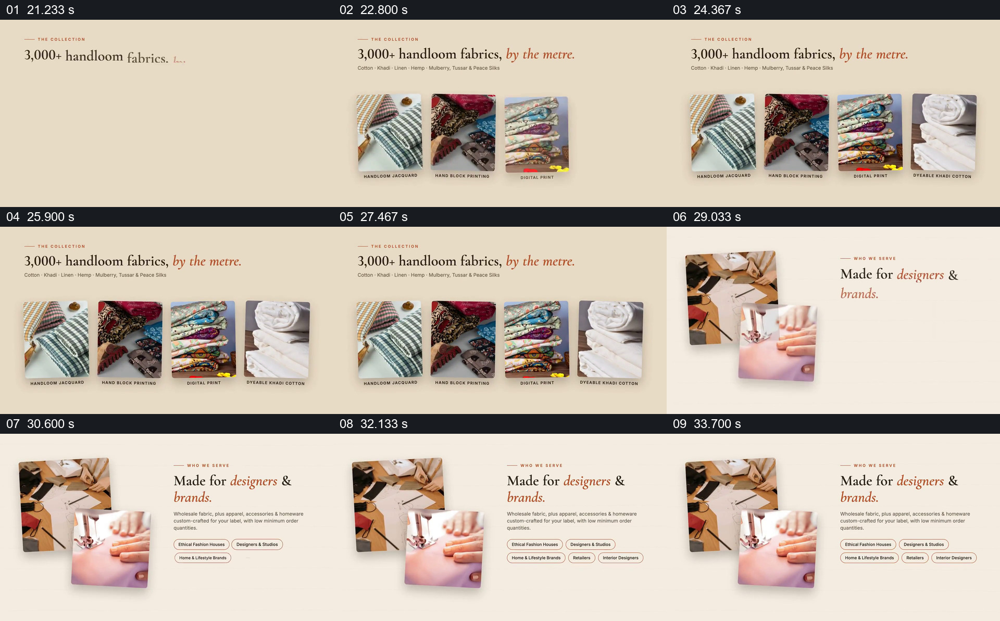

# 先展示面料种类，再说明谁会使用

- 作品：案例 014《织物照片与品牌叙事》（索引名称）。
- 原片范围：00:21.000–00:35.000，含起点、不含终点；[完整原片](../video.mp4)｜[本卡片段](c03.mp4)。
- 观察方式：依据整片 64 宫格和约每秒一次的真实源帧观察，未连续原速观看；媒体探测显示原片没有音轨，因此没有可听审的原声。

## 原画面具体怎样设计

浅色页面顶部写“3,000+ handloom fabrics, by the metre.”，下方依次出现四张不同织物照片和小标签。整组停留后换页：左侧叠放设计与处理布料的照片，右侧标题为“Made for designers & brands.”，下面排列短说明与标签。

## 为什么这样设计，好在哪里

先看到材料的具体外观，再看到面向的使用者，使“品类”和“用途”各有自己的阅读空间。统一版式把两页连成同一产品介绍；数字和用户群体是宣传文本，不可从展示的四张照片推导。

以上为依据画面的分析，非作者自述；预期观看效果未经观众测试。

## 可直接使用的创意指令

当既要让观众理解材料范围，又要交代其用途时，选取少量确有区别的代表品类，保持图片比例和名称对应，先让整组被看清；然后切到能显示真实使用情境的照片与对象说明。若有品类总数，标注统计范围和来源；照片与标签随实际产品调整，避免把样例数量当作完整清单。
