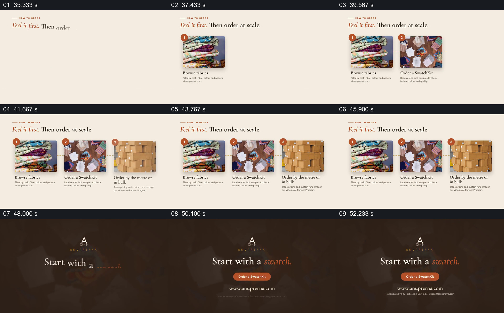

# 让浏览、取样和采购依次成列，再收束到取样入口

- 作品：案例 014《织工、面料与产品信息》（库内索引名）。
- 原片范围：00:35.000–00:54.000；[完整原片](../video.mp4)｜[本卡片段](c04.mp4)，片段起点对应源时间 35.000 秒。
- 边界依据：三张带编号的图片逐步组成订购流程，最终品牌页突出样品入口。 之后进入下一项独立表达。
- 观察方式：核看全片 64 帧总览及本卡九宫格；原片无音轨，未独立连续原速观看。广告主张未独立查证，迁移效果未实测。

## 原画面具体怎样设计

米色背景上标题为“Feel it first. Then order at scale.”；布料、样品包与纸箱三张图片依次排列，每张左上有编号，下方分别为浏览、订购样品包和按米或批量订购，虚线连接各步。随后画面换深棕底，品牌标识、“Start with a swatch”、样品按钮与网址居中，作为最终行动入口。

## 为什么这样设计，好在哪里

图片把各步具体做什么放在文字上方，三步累积后同时可见，形成可回看的完整路径；片尾只保留第一步行动，减少选择负担。按钮与商业条件是片中演示，未确认当前有效。

## 可直接使用的创意指令

如果真实购买流程包含浏览、体验与后续订购，选择每步能被辨认的实物或界面，为它们给出顺序和简短说明；已出现的步骤保持到全流程形成，再将观众交给可执行的下一入口。步骤数量、照片和版式可变；实际入口及条款应核实。
