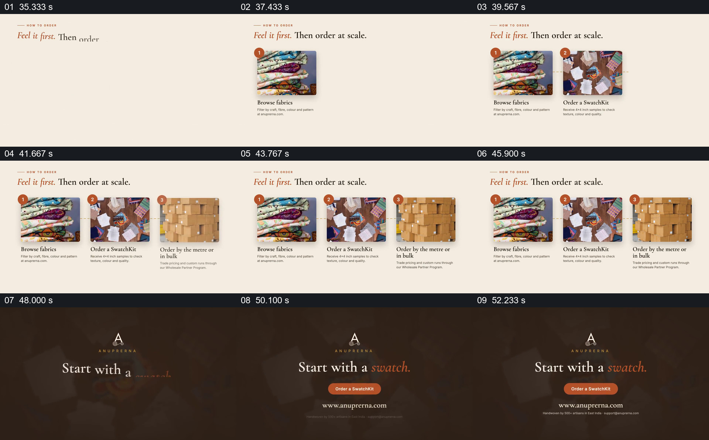

# 让浏览、取样和采购依次成列，再收束到取样入口

- 作品：案例 014《织工、面料与产品信息》（库内索引名）。
- 原片范围：00:35.000–00:54.000；[完整原片](../video.mp4)｜[本卡片段](c04.mp4)，片段起点对应源时间 35.000 秒。
- 边界依据：三张带编号的图片逐步组成订购流程，最终品牌页突出样品入口。 之后进入下一项独立表达。
- 观察方式：核看全片 64 帧总览及本卡九宫格；原片无音轨，未独立连续原速观看。广告主张未独立查证，迁移效果未实测。

## 原画面具体怎样设计

米色背景上标题为“Feel it first. Then order at scale.”；布料、样品包与纸箱三张图片依次排列，每张左上有编号，下方分别为浏览、订购样品包和按米或批量订购，虚线连接各步。随后画面换深棕底，品牌标识、“Start with a swatch”、样品按钮与网址居中，作为最终行动入口。

## 为什么这样设计，好在哪里

图片把各步具体做什么放在文字上方，三步累积后同时可见，形成可回看的完整路径；片尾只保留第一步行动，减少选择负担。按钮与商业条件是片中演示，未确认当前有效。

## 完整照排指令

以[完整原片](../video.mp4)的 35–54 秒为准。画幅 1280×720，源帧率 30/1。以下拍点为抽帧定位，位置按画幅百分比取近似值。

### 用料

准备同一选购流程的【浏览布样】【取样实物】【采购备料】，取同一产品线，最好能从堆叠样布认出送样及后续采购布料。各配【步骤名一】【步骤名二】【步骤名三】和【步骤说明一】【步骤说明二】【步骤说明三】。另备【流程标题】【品牌标记】【片尾标题】【取样按钮】【取样地址】【深布底图】。真实入口、样品条款和交付范围需可核对。

### 按源时刻摆放

1. **35.000–约 38.000 秒。** 暖米白底，左上 x7%、y9% 以较大深棕衬线排【流程标题】，开头一短组用赭色斜体。第一张近方【浏览布样】位在左栏，宽约画宽四分之一。圆形橙色编号压在图左上边，标题和说明紧贴图下左齐，深棕【步骤名一】比【步骤说明一】大一档。右两列先留白。
2. **约 38.000–41.500 秒。** 中栏【取样实物】先淡入再立稳，随后右栏【采购备料】接上。各图沿首卡同一基线，间隔窄而明确。第二、三张沿用圆形橙编号并各排【步骤名二】【步骤说明二】、【步骤名三】【步骤说明三】。已入场卡均保持，右卡落稳后三步同屏至整版切出。照片可定格或轻推，动态实物只在对应窗位连续显示，不能把前一步的样品换成另一品类来省料。
3. **约 41.500–46.500 秒。** 三卡与标题保持，末段让浅面整体退去。留足辨认从浏览到取样再到采购的时间，压低说明行，避免与步骤名同级。
4. **约 46.500–54.000 秒。** 用近黑暖棕【深布底图】铺满，回到开篇材质。中轴上方是小浅【品牌标记】，中部用暖白衬线【片尾标题】，末词赭橙斜体；稍后在下方落小橙圆角【取样按钮】，其下放细暖白【取样地址】。静态布纹可缓移，按钮持续到索引边界切出。

### 局部采用

只有样布浏览及取样材料，可采用 35–约 40 秒的前两卡，另留读停顿。已有真实取样地址时可单用约 46.500–54 秒片尾。

### 验证状态

已对照逐秒原片画序并读回，核对三卡逐列累积、编号压角、浅底流程到深底入口的切换。精确切点、原速听看和换料试摆待核。
